[English](README.md) · [فارسی](README.fa.md) · **العربية** · [Español](README.es.md) · [Français](README.fr.md) · [Русский](README.ru.md) · [中文](README.zh.md)

<div align="center">


<a href="https://teka-nexus.vercel.app/">
  
</a>

<br>

[](https://teka-nexus.vercel.app/)
[](https://nextjs.org)
[](https://www.typescriptlang.org)
[](https://developer.mozilla.org/docs/Web/Progressive_web_apps)
[](LICENSE)

<br>

[](https://github.com/mhmdsdqi87-cloud/TEKA-NEXUS/releases)
[](https://github.com/mhmdsdqi87-cloud/TEKA-NEXUS/stargazers)
[](https://github.com/mhmdsdqi87-cloud/TEKA-NEXUS/forks)
[](https://github.com/mhmdsdqi87-cloud/TEKA-NEXUS/issues)
[](https://github.com/mhmdsdqi87-cloud/TEKA-NEXUS/commits/main)
[](https://github.com/mhmdsdqi87-cloud/TEKA-NEXUS)
[](#internationalization)

<br>

[🚀 المنصة المباشرة](https://teka-nexus.vercel.app/) · [📱 إصدار أندرويد](https://github.com/mhmdsdqi87-cloud/TEKA-NEXUS/releases/tag/myket-v1.0.1) · [🤝 المساهمة](CONTRIBUTING.md) · [🐛 البلاغات](https://github.com/mhmdsdqi87-cloud/TEKA-NEXUS/issues) · [👤 GitHub](https://github.com/mhmdsdqi87-cloud) · [✉️ تواصل](mailto:mhmdsdqi87@gmail.com)


<sub><b>موجز اجتماعي · أكاديمية مجانية بـ ٣٠٠ درس · ١٢ وحدة للحلبة · Live Universe · Project DNA — ٧ لغات، منصة واحدة.</b></sub>

</div>


## 👤 صُنع بيد إنسان واحد

> **TEKA NEXUS صُمّم وطُوّر واختُبر وشُغّل من الألف إلى الياء بشخصٍ واحدة — ليس فخرًا، بل ضرورةً: لم يكن هنالك أحدٌ غيره.**

| | |
|---|---|
| **المؤلف** | **Mohammad Sadeghi** (محمد صادقی) |
| **الدور** | مؤسِّس · مطوِّر Full-Stack متعلّم ذاتيًا · مصمِّم منتجات |
| **GitHub** | <https://github.com/mhmdsdqi87-cloud> |
| **البريد الإلكتروني** | <mailto:mhmdsdqi87@gmail.com> |

لم يكن ثمة معلّمٌ يُسأل عند الثانية فجرًا، ولا فريقٌ يتقاسم الحِمل، ولا شهادةٌ تفتح الأبواب — كان هنالك الإنترنت وحده، وليالٍ طويلة، وعنادٌ أكثر من الشهادات. وكل طبقة من هذا المنتج — لغة تجربة المستخدم، ومخطط قاعدة بيانات يضم ٤٥ نموذجًا، وأربعة محركات لتصحيح الشيفرة آليًا، و٣٠٠ درس من محتوى ثنائي اللغة، وحلبة من ١٢ وحدة ألعاب، وسبع واجهات مكتملة التعريب — تعلّمها صانعها بالطريقة الوحيدة التي يعرفها: البناء، ثم التكسير، ثم إعادة البناء حتى يعمل.

> 🎓 *هذا المستودع بورتفوليو حيّ — ليس برهانًا على المعرفة، بل دليلًا على الرغبة. مفتوحٌ للفرص الأكاديمية والمهنية.*
>
> 🇷🇺 *حلمي أن أواصل تعليمي في روسيا. الرسالة نفسها — المكتوبة بالروسية، بغورٍ وصدقٍ — تعيش في صفحة «حول» من المنصة («В надежде на учёбу в России»).*


## 🌍 ما هو TEKA NEXUS؟

<div align="center">



</div>

بدأ TEKA NEXUS بسؤالٍ واحد: **لماذا يجب أن يكون تعلّم البرمجة صعبًا؟**

إنها منظومة متكاملة تمزج **التواصل والبناء والتعلّم** في تجربة واحدة سلسة وقابلة للتثبيت — ليست موقع دوراتٍ أُلصق به منتدى، بل **حلبة اجتماعية** للجيل القادم من المطورين؛ بواجهة فارسية أولًا، ومفتوحة على العالم.

<div align="center">

| | | |
|:---:|:---:|:---:|
| 🧭 **اكتشاف**<br><sub>بثٌّ تقني حقيقي — مشاريع وبنّاؤون، وسمعة تُكتسب بالـ*عمل*</sub> | 🤝 **البناء**<br><sub>مساحات عمل للمشاريع: كانبان، مراحل رئيسية، **دردشة فريق لحظية**</sub> | 🎓 **التعلّم**<br><sub>٣٠٠ درس تطبيقي، بايثون داخل المتصفح، وتحديات تُصحَّح آليًا</sub> |
| 🏆 **الحلبة**<br><sub>١٢ وحدة ألعاب، كلٌّ منها واجهة من الطراز الأول في شريط التنقل الرئيسي</sub> | 🌌 **Live Universe**<br><sub>كرة أرضية ثلاثية الأبعاد من بيانات المجتمع الحقيقية — لا أرقام مفبركة، أبدًا</sub> | 🧬 **Project DNA**<br><sub>هوية رقمية موثّقة لكل مشروع</sub> |
| 🎮 **اللعب**<br><sub>اقتصاد XP، بطاقات قابلة للتجميع، سلاسل أيام متتالية، وليالي TEKA الشهرية</sub> | 🔐 **الأمان**<br><sub>مصادقة scrypt، وواجهات API مدقّقة عبر zod، ومنع غش على جانب الخادم</sub> | 🌐 **اللغات**<br><sub>٧ لغات كاملة مع RTL حقيقي للفارسية والعربية</sub> |

</div>

<details>
<summary><b>🖼️ عِش المنتج عن قرب — معرض الصور</b></summary>

<div align="center">

| قتال الزعيم في الحلبة | شجرة المهارات | الرفيق الأليف |
|:---:|:---:|:---:|
|  |  |  |

| بطاقات المبرمج | وضع المصفوفة | الطرفية |
|:---:|:---:|:---:|
|  |  |  |

</div>

</details>


## 🧬 المحرك العالمي — ثمانية أنظمة، مركز واحد

<div align="center">



</div>

الجيل القادم من TEKA NEXUS هو **توسّع بثمانية أنظمة** — وسجلّ البناء متاحٌ للعامة، كوميتًا بعد كوميت:

| # | النظام | الحالة |
|:---:|---|---|
| ١ | 🌌 **Live Universe** — كرة أرضية ثلاثية الأبعاد بتقنية WebGL تعرض تجميعات بيانات *حقيقية* للمجتمع عبر `/api/universe` | ✅ **أُصدر** — `v1.74.0` |
| ٢ | 🧬 **Project DNA** — هوية رقمية موثّقة وسجلّ تاريخي لكل مشروع | ✅ **أُصدر** — `v1.75.0` |
| ٣ | 🤖 **AI Autonomous Studio** — ستة وكلاء متخصصين مع نقاط اعتماد بشريّة | 🚧 مخطط له |
| ٤ | ⚔️ **War Room** — سجلات قرارات دائمة: السياق، الخيارات، الحكم النهائي | 🚧 مخطط له |
| ٥ | 🧠 **Code Intelligence** — ذكاء تحليلي للمستودعات عبر GitHub بـ *OAuth فقط*؛ لا كلمات مرور أبدًا، ولا تنفيذ لشيفرة غير موثوقة | 🚧 مخطط له |
| ٦ | 🏅 **Global Challenges** — مسابقات هندسية محكَّمة | 🚧 مخطط له |
| ٧ | 🕸️ **Knowledge Graph** — بحث دلالي فوق بيانات حقيقية مفهرسة | 🚧 مخطط له |
| ٨ | 👯 **Digital Twin** — قياسات تُوسَم دائمًا: *فعلي / محسوب / محاكى / متوقَّع بالذكاء الاصطناعي* | 🚧 مخطط له |

<div align="center">



</div>

> ⚠️ **قانون النزاهة عندنا:** لا نعرض التقديرات على أنها حقائق أبدًا، ولا نطلق بيانات وهمية على أنها معلومات حقيقية، ولا نعلّم شيئًا بأنه «مكتمل» ما لم يُختبر من طرف إلى طرف. ما تراه مُعلَّمًا أعلاه هو بالضبط ما يوجد فعلًا.


## 🎓 أكاديمية TEKA — ٣٠٠ درس، بلا أي إعداد

أربعة مسارات، كلٌّ منها مُهندَس حول **الفعل**، لا المشاهدة:

| المسار | الدروس | المحرك |
|---|:---:|---|
| 🐍 **بايثون** | ٧٦ | **مفسّر pylite** — مجموعة فرعية من بايثون تعمل بالكامل داخل المتصفح |
| 🌐 **HTML** | ٧٣ | معاينة حية + **تأكيدات DOM** |
| 🎨 **CSS** | ٨١ | معاينة حية + **تصحيح الأنماط المحسوبة (computed-style)** مقابل DOM المُصيَّر |
| ⚡ **جافاسكريبت** | ٧٠ | بيئة تشغيل داخل iframe معزولة مع **اختبارات حتمية** |

**٣٠٠ درس في المجموع** — كل درس ثنائي اللغة، مُكثَّف وعملي. المنهجية: **خطوتان نظريتان ← اختبار قصير ← تحدٍّ يُصحَّح آليًا** (شيفرة بداية، حل نموذجي، ٣ تلميحات متدرجة).

ويُضاف إلى ذلك **بوابة التعلّم**: مسارات تعلم، وBug Detective، وموسوعة الأخطاء، وPredict-the-Output، ومسرد ثنائي اللغة، وعلامات مرجعية، وسلسلة أيام متتالية، و١٢ إنجازًا، ومستكشف `Ctrl+K` ببحث نصي شامل، و**معلّم سقراطي بالذكاء الاصطناعي** (LLM على جانب الخادم — لا تصل المفاتيح إلى المتصفح أبدًا).

### 🏅 ترخيص TEKA الرسمي
**امتحان نهائي تحت المراقبة** (١٥ دقيقة، تصحيح من جانب الخادم، بحد أقصى ٣ محاولات، ومنع غش على الخادم) ← شهادة قابلة للتحقق بمعرّف فريد لكل مسار.

## 🏆 حلبة TEKA — طبقة الألعاب

كل وحدة تسكن **مباشرة في شريط التنقل الرئيسي** — لا نوافذ منبثقة، ولا طبقات وسيطة؛ كل لعبة تجربة ملء الشاشة من الطراز الأول:

- 🟢 **وضع المصفوفة** — طبقة شيفرة متساقطة تملأ الشاشة (`Ctrl+Shift+M`)
- 🌌 **شريط TEKA NIGHTS** — عدّ تنازلي حيّ حتى الحدث الشهري القادم
- 🔗 **روابط عميقة** — الأمر `teka learn css` يفتح الأكاديمية مباشرة عند دورة CSS
- ⌨️ **الطرفية** — غلاف أوامر حقيقي: `teka boss` و`matrix on` و`neofetch`… وسرٌّ واحد

<details>
<summary><b>وحدات الحلبة الاثنتا عشرة</b></summary>

| التطبيق | ماذا يفعل |
|---|---|
| 🗺️ **شجرة المهارات** | تقدّم بخريطة على طراز المجرّة — تُفتح العُقد عند استكمال المتطلبات |
| ⚔️ **قتال الزعيم** | زعيم في نهاية كل دورة؛ اهزمه ← تكسب ألقابًا مثل *“Python Slayer”* |
| 🐣 **الرفيق الأليف** | بيضة تفقس كلما تعلمت؛ تغب ٣ أيام فيشتد جوعه |
| 🔴🔵 **حرب الأحمر والأزرق** | اختر معسكرك عند التسجيل؛ حروب أسبوعية بنقاط فريق حيّة |
| 🃏 **بطاقات المبرمج** | بطاقات قابلة للتجميع بأرقام تسلسلية ودرجات ندرة |
| 🪙 **المتجر** | أنفق عملات TEKA على إطارات وتعزيزات وحزم بطاقات |
| 🕵️ **مسرح الجريمة** | ألعاب مصغّرة في التحقيق الجنائي الرقمي: سجلات وعناوين IP — أغلق القضية |
| ⏱️ **السباق السريع** | مؤقّتات عالمية للوحدات مع لوحة أرقام قياسية |
| ⏳ **آلة الزمن** | إعادة عرض متحركة لرحلة تعلّمك بأكملها |
| 🔥 **خريطة النشاط الحرارية** | شبكة نشاط يومية على طراز GitHub |
| 🎙️ **غرف الصوت** | غرف مواضيع تُسرد رسائلها صوتيًا بالذكاء الاصطناعي (TTS على جانب الخادم) |
| ⌨️ **الطرفية** | غلاف أوامر حقيقي بأوامر حيّة |

</details>

## ✨ جولة في الميزات

<details open>
<summary><b>التواصل الاجتماعي والتعاون</b></summary>

- منشورات، إعجابات، تعليقات، إعادة نشر، علامات مرجعية، وبحث بالوسوم
- متابعة / حظر / كتم، وإشعارات دقيقة التفصيل (داخل التطبيق وعدّادات الشارات)
- رسائل مباشرة مع حالة القراءة
- مساحات عمل للمشاريع: مهام كانبان، مراحل رئيسية، تحديثات، وروابط ملفات
- **دردشة فريق** لحظية عبر خدمة مصغّرة مخصصة بـ socket.io (التواجد، الكتابة، التفاعلات، السجل)
- طلبات تعاون مع تفاوض على الأدوار (مساهم / مشاهد)
- تكامل مع GitHub: لوحات مستودعات، ومساهمون من المجتمع
- لوحة المؤسِّس: إحصاءات مجتمع حيّة + إدارة الأعضاء (بحسب الدور)

</details>

<details>
<summary><b>المصادقة والأمان</b></summary>

- بريد إلكتروني/كلمة مرور مع تشفير **scrypt** (ملح فريد لكل مستخدم، `timingSafeEqual`)
- كوكيز جلسات httpOnly، وجلسات مدتها ٣٠ يومًا على جانب الخادم
- جميع نقاط نهاية REST — أكثر من ٦٠ — مدقّقة عبر zod؛ والتصريح يُفحص لكل طلب على جانب الخادم
- منع الغش في الامتحانات والسباقات السريعة يُطبَّق **على جانب الخادم**
- الذكاء الاصطناعي وTTS يمرّان عبر مسارات الخادم فقط — لا يصل أي مفتاح إلى المتصفح أبدًا

</details>

<details>
<summary><b>التجربة والمنصة</b></summary>

- **تسلسل إقلاع سينمائي**: لوحة شبكة عصبية، حلقات مدارية، وسجل إقلاع طرفية (نحو ٨ ثوانٍ، مع احترام `prefers-reduced-motion`)
- لغة تصميم **زجاجية (Glassmorphism)**: ضبابية متعددة الطبقات، لمسات نيون، وفيزياء نابضة (framer-motion)
- **PWA**: قابلة للتثبيت، أيقونات بهوية العلامة، وعامل خدمة آمن (في الإنتاج فقط)
- دعم **RTL** كامل للفارسية والعربية (مكونات واعية بالاتجاه)
- خريطة نشاط على طراز GitHub، سلاسل أيام متتالية، عدّادات إحصاءات متحركة، نظام تنبيهات منبثقة، وهياكل تحميل في كل مكان

</details>


## 🏗️ المعمارية

```text
┌────────────────────────────────────────────────────────────────────┐
│                        Browser (PWA client)                        │
│  Next.js 16 App Router SPA — zustand router, framer-motion, 7 i18n │
│  TEKA Arena · pylite interpreter · sandboxed iframes               │
└──────────────────────────────┬─────────────────────────────────────┘
                               │  REST (zod-validated, session cookie)
┌──────────────────────────────▼─────────────────────────────────────┐
│                     Next.js API routes (60+)                       │
│  auth · social · projects · academy · exam · arena (12 modules) ·  │
│  universe · dna · tts · server-side grading · anti-cheat · LLM proxy│
└───────────────┬────────────────────────────────┬───────────────────┘
                │ Prisma ORM                     │ socket.io client
┌───────────────▼────────────────┐  ┌────────────▼───────────────────┐
│   PostgreSQL (Supabase)        │  │  mini-services/chat-service    │
│   30+ models: User, Post,      │  │  dedicated Bun process, own    │
│   Project, Task, Session,      │  │  port & package.json — real-   │
│   License, War*, Pet*, Card*,  │  │  time team chat (rooms, pres-  │
│   Speedrun*, Activity …        │  │  ence, typing, reactions)      │
└────────────────────────────────┘  └────────────────────────────────┘
```

### الحزمة التقنية

<div align="center">
  <a href="https://skillicons.dev">
    
  </a>
</div>

| الطبقة | الاختيار | لماذا |
|---|---|---|
| إطار العمل | **Next.js 16** (App Router، إخراج standalone) | قشرة SPA جاهزة لـ RSC، وهدف نشر واحد |
| اللغة | **TypeScript 5** بوضع strict | أمان أنواع من الطرف إلى الطرف، وقواميس مُنمَّطة لسبع لغات |
| التنسيق | **Tailwind CSS 4** + shadcn/ui + Lucide | نظام تصميم زجاجي/نيوني متّسق |
| الحركة | framer-motion | فيزياء نابضة، انتقالات صفحات، وتأثيرات الحلبة |
| قاعدة البيانات | **Prisma ORM** → PostgreSQL (Supabase للإنتاج / SQLite للتطوير) | مخطط مُنمَّط، أكثر من ٣٠ نموذجًا، وصفر انحراف في SQL |
| الزمن الحقيقي | خدمة مصغّرة socket.io (Bun) | توسّع معزول ونطاق انهيار مستقل للدردشة |
| الذكاء الاصطناعي | معلّم LLM على جانب الخادم + سرد صوتي TTS | مساعدة مخصّصة، ودروس صوتية |
| الاستضافة | Vercel (الواجهة وAPI) · Supabase (قاعدة البيانات) | CI/CD عند كل دفع، وبلا أي عمليات يدوية |

## 🌐 التدويل

<div align="center">

**English** 🇬🇧 · فارسی 🇮🇷 · العربية 🇸🇦 · Español 🇪🇸 · Français 🇫🇷 · Русский 🇷🇺 · 中文 🇨🇳

</div>

قواميس مُنمَّطة، وتواريخ وأرقام واعية باللغة، وانعكاس RTL كامل للفارسية والعربية، واكتشاف لغة المتصفح مع تذكّرها. صفحة README هذه تتحدث اللغات السبع كلها أيضًا — بدّل لغتك من الأعلى تمامًا. ⬆️


## 🚀 البدء السريع

```bash
# 1. install
bun install                        # or: npm / pnpm / yarn

# 2. environment
cp .env.example .env               # SQLite works out of the box for local dev
#   DATABASE_URL="file:./db/custom.db"          ← dev default
#   For Supabase Postgres see docs/SUPABASE.md

# 3. schema
bun run db:push

# 4. run
bun run dev                        # http://localhost:3000

# 4b. real-time chat service (optional, separate terminal)
cd mini-services/chat-service && bun run dev
```

> 📦 **الإنتاج**: Vercel + Supabase — دليل التشغيل الكامل في [`docs/DEPLOY.md`](docs/DEPLOY.md) (بما في ذلك تغليف حزم AAB لأندرويد عبر TWA لمتاجر التطبيقات).

## 🗺️ خارطة الطريق

- [x] 🌌 **Live Universe** — كرة WebGL ببيانات حقيقية (`v1.74.0`)
- [x] 🧬 **Project DNA** — هوية موثّقة للمشروع (`v1.75.0`)
- [ ] 🤖 **AI Autonomous Studio** — ٦ وكلاء، ونقاط اعتماد بشريّة
- [ ] ⚔️ **War Room** — سجلات القرارات
- [ ] 🧠 **Code Intelligence** — ذكاء للمستودعات عبر GitHub بـ OAuth فقط
- [ ] 🏅 **Global Challenges** — مسابقات محكَّمة
- [ ] 🕸️ **Knowledge Graph** — بحث دلالي
- [ ] 👯 **Digital Twin** — قياسات موسومة
- [ ] **Hack Zone** — تحديات أمنية بأسلوب CTF مع سلّم رتب للهُكر
- [ ] صوت WebRTC في غرف الصوت · لوحات صدارة موسمية · مبارزات Code Battle 1v1
- [ ] مسارات إضافية: Git، SQL، React، ومنهج **الأمن السيبراني** كاملًا
- [ ] 🇷🇺 فصل منح روسيا — ملف قبول ثنائي اللغة (ru/en)

## 🤝 المساهمة

بُني هذا المشروع بشخصٍ واحدة — **المساهمات ليست مرحَّبًا بها فحسب، بل هي المستقبل**.

| بوابة الدخول | ابدأ من هنا |
|---|---|
| 💻 الشيفرة | [`CONTRIBUTING.md`](CONTRIBUTING.md) → اختر بلاغًا → PR |
| 🌍 الترجمة | حسّن أيًّا من اللغات السبع في `src/lib/i18n/` أو ترجم المستندات |
| 🎓 المحتوى | اقترح دروسًا أو أفكار تحديات للأكاديمية |
| 🐛 صيد الأخطاء | بلّغ في [البلاغات](https://github.com/mhmdsdqi87-cloud/TEKA-NEXUS/issues) — خطوات إعادة الإنتاج تكسب القلوب |
| ⭐ الدعم | ضع نجمة للمستودع، وشاركه مع صديق واحد يتعلم البرمجة |

اقرأ [مدونة السلوك](CODE_OF_CONDUCT.md). المشكلات الأمنية → [`SECURITY.md`](SECURITY.md) (الإفصاح المسؤول).


## 📊 مقاييس المستودع

<div align="center">

<a href="https://github.com/mhmdsdqi87-cloud/TEKA-NEXUS">
  
</a>
<a href="https://github.com/mhmdsdqi87-cloud/TEKA-NEXUS">
  
</a>

<a href="https://github.com/mhmdsdqi87-cloud/TEKA-NEXUS">
  
</a>


<picture>
  <source media="(prefers-color-scheme: dark)" srcset="https://raw.githubusercontent.com/mhmdsdqi87-cloud/TEKA-NEXUS/output/github-contribution-grid-snake-dark.svg">
  <source media="(prefers-color-scheme: light)" srcset="https://raw.githubusercontent.com/mhmdsdqi87-cloud/TEKA-NEXUS/output/github-contribution-grid-snake.svg">
  
</picture>

<picture>
  <source media="(prefers-color-scheme: dark)" srcset="https://api.star-history.com/svg?repos=mhmdsdqi87-cloud/TEKA-NEXUS&type=Date&theme=dark">
  <source media="(prefers-color-scheme: light)" srcset="https://api.star-history.com/svg?repos=mhmdsdqi87-cloud/TEKA-NEXUS&type=Date">
  
</picture>

</div>

## 📜 الترخيص والإشادات

بُني بأملٍ عنيد — وليالٍ أكثر من النوم — على يد **Mohammad Sadeghi**.
جميع تسميات المنتج ولغة التصميم ومحتوى الدورات © ٢٠٢٥ Mohammad Sadeghi.
صدر تحت [ترخيص MIT](LICENSE).

📘 سجل الإصدارات: [CHANGELOG.md](CHANGELOG.md) · 🗺️ خارطة الطريق المفصلة: [docs/ROADMAP.md](docs/ROADMAP.md)

---

<div align="center">


<sub><i>تصميم · هندسة · اختبار · تشغيل — بشخصٍ واحدة. مفتوحٌ للجميع.</i></sub>



⭐ **إن ألهمك هذا المشروع، فنجمةٌ واحدة تعني العالم كله لصانعٍ منفرد.**

<a href="https://github.com/mhmdsdqi87-cloud">GitHub</a> · <a href="https://teka-nexus.vercel.app/">المنصة المباشرة</a> · <a href="mailto:mhmdsdqi87@gmail.com">mhmdsdqi87@gmail.com</a>

</div>
