[English](README.md) · [فارسی](README.fa.md) · [العربية](README.ar.md) · **Español** · [Français](README.fr.md) · [Русский](README.ru.md) · [中文](README.zh.md)

<div align="center">


<a href="https://teka-nexus.vercel.app/">
  
</a>

<br>

[](https://teka-nexus.vercel.app/)
[](https://nextjs.org)
[](https://www.typescriptlang.org)
[](https://developer.mozilla.org/docs/Web/Progressive_web_apps)
[](LICENSE)

<br>

[](https://github.com/mhmdsdqi87-cloud/TEKA-NEXUS/releases)
[](https://github.com/mhmdsdqi87-cloud/TEKA-NEXUS/stargazers)
[](https://github.com/mhmdsdqi87-cloud/TEKA-NEXUS/forks)
[](https://github.com/mhmdsdqi87-cloud/TEKA-NEXUS/issues)
[](https://github.com/mhmdsdqi87-cloud/TEKA-NEXUS/commits/main)
[](https://github.com/mhmdsdqi87-cloud/TEKA-NEXUS)
[](#internationalization)

<br>

[🚀 Plataforma en vivo](https://teka-nexus.vercel.app/) · [📱 APK de Android](https://github.com/mhmdsdqi87-cloud/TEKA-NEXUS/releases/tag/myket-v1.0.1) · [🤝 Contribuir](CONTRIBUTING.md) · [🐛 Issues](https://github.com/mhmdsdqi87-cloud/TEKA-NEXUS/issues) · [👤 GitHub](https://github.com/mhmdsdqi87-cloud) · [✉️ Contacto](mailto:mhmdsdqi87@gmail.com)


<sub><b>Feed social · academia gratuita de 300 lecciones · 12 módulos de Arena · Live Universe · Project DNA — 7 idiomas, una plataforma.</b></sub>

</div>


## 👤 Construido por una sola persona

> **TEKA NEXUS fue diseñado, desarrollado, probado y operado de punta a punta por una sola persona — no por orgullo, sino por necesidad: no había nadie más.**

| | |
|---|---|
| **Autor** | **Mohammad Sadeghi** (محمد صادقی) |
| **Rol** | Fundador · Desarrollador Full-Stack autodidacta · Diseñador de producto |
| **GitHub** | <https://github.com/mhmdsdqi87-cloud> |
| **Email** | <mailto:mhmdsdqi87@gmail.com> |

No había un maestro a quien preguntar a las 2 de la madrugada, ni un equipo con quien
repartir el peso, ni un título que abriera puertas — solo internet, noches largas y
más terquedad que credenciales. Cada capa de este producto — el lenguaje de UX, el
esquema de base de datos de 45 modelos, cuatro motores de corrección automática de
código, 300 lecciones de contenido bilingüe, una Arena de 12 módulos de juego y siete
interfaces totalmente localizadas — se aprendió de la única manera que su creador
conoce: construyendo, rompiendo y volviendo a construir hasta que funciona.

> 🎓 *Este repositorio es un portafolio vivo — no la prueba de saber, sino la evidencia
> de querer. Abierto a oportunidades académicas y profesionales.*
>
> 🇷🇺 *Mi sueño es continuar mi formación en Rusia. La carta en sí — escrita en ruso,
> humilde y honesta — vive en la página About de la plataforma («В надежде на учёбу в России»).*


## 🌍 ¿Qué es TEKA NEXUS?

<div align="center">



</div>

TEKA NEXUS nació de una sola pregunta: **¿por qué aprender a programar debería ser difícil?**

Es un ecosistema completo que funde **conectar, construir y aprender** en una sola
experiencia fluida e instalable — no un sitio de cursos con un foro pegado, sino una
**arena social** para la próxima generación de desarrolladores, con el persa como eje,
abierta al mundo.

<div align="center">

| | | |
|:---:|:---:|:---:|
| 🧭 **Descubrir**<br><sub>Un feed tecnológico real — proyectos, creadores, reputación ganada con *acciones*</sub> | 🤝 **Construir**<br><sub>Espacios de trabajo para proyectos: kanban, hitos, **chat de equipo en tiempo real**</sub> | 🎓 **Aprender**<br><sub>300 lecciones prácticas, Python en el navegador, desafíos con corrección automática</sub> |
| 🏆 **Arena**<br><sub>12 módulos de juego como vistas de primera clase en la navegación principal</sub> | 🌌 **Live Universe**<br><sub>Un globo 3D con datos reales de la comunidad — sin números falsos, jamás</sub> | 🧬 **Project DNA**<br><sub>Una identidad digital verificada para cada proyecto</sub> |
| 🎮 **Jugar**<br><sub>Economía de XP, cartas coleccionables, rachas, TEKA Nights mensuales</sub> | 🔐 **Seguridad**<br><sub>Autenticación scrypt, APIs validadas con zod, anti-trampas del lado del servidor</sub> | 🌐 **Hablar**<br><sub>7 idiomas completos con RTL real para persa y árabe</sub> |

</div>

<details>
<summary><b>🖼️ Siente el producto — galería</b></summary>

<div align="center">

| Boss Fight de la Arena | Árbol de habilidades | Code Pet |
|:---:|:---:|:---:|
|  |  |  |

| Coder Cards | Modo Matrix | Terminal |
|:---:|:---:|:---:|
|  |  |  |

</div>

</details>


## 🧬 El Motor Global — ocho sistemas, un solo nexo

<div align="center">



</div>

La próxima generación de TEKA NEXUS es una **expansión de ocho sistemas** — y el
registro de construcción es público, commit a commit:

| # | Sistema | Estado |
|:---:|---|---|
| 1 | 🌌 **Live Universe** — un globo 3D en WebGL que muestra agregados *reales* de la comunidad vía `/api/universe` | ✅ **Desplegado** — `v1.74.0` |
| 2 | 🧬 **Project DNA** — una identidad e historial digital verificados para cada proyecto | ✅ **Desplegado** — `v1.75.0` |
| 3 | 🤖 **AI Autonomous Studio** — seis agentes especializados con puntos de aprobación humana | 🚧 Planificado |
| 4 | ⚔️ **War Room** — registros permanentes de decisiones: contexto, opciones, veredictos | 🚧 Planificado |
| 5 | 🧠 **Code Intelligence** — inteligencia de repositorios GitHub *solo vía OAuth*; nunca contraseñas, nunca ejecución de código no confiable | 🚧 Planificado |
| 6 | 🏅 **Global Challenges** — competencias de ingeniería con jurado | 🚧 Planificado |
| 7 | 🕸️ **Knowledge Graph** — búsqueda semántica sobre datos reales indexados | 🚧 Planificado |
| 8 | 👯 **Digital Twin** — telemetría siempre etiquetada: *real / calculada / simulada / predicha por IA* | 🚧 Planificado |

<div align="center">



</div>

> ⚠️ **Regla de integridad de la casa:** nunca presentamos estimaciones como hechos,
> nunca enviamos datos ficticios como información real, y nunca marcamos nada como
> «terminado» sin haberlo probado de punta a punta. Lo que ves marcado arriba es
> exactamente lo que existe.


## 🎓 TEKA Academy — 300 lecciones, sin configuración

Cuatro itinerarios, cada uno diseñado en torno a **hacer**, no a mirar:

| Itinerario | Lecciones | Motor |
|---|:---:|---|
| 🐍 **Python** | 76 | Intérprete **pylite** propio — un subconjunto de Python que se ejecuta íntegramente en el navegador |
| 🌐 **HTML** | 73 | Vista previa en vivo + **aserciones de DOM** |
| 🎨 **CSS** | 81 | Vista previa en vivo + **corrección por computed-style** contra el DOM renderizado |
| ⚡ **JavaScript** | 70 | Runtime de iframe aislado (sandbox) con **pruebas deterministas** |

**300 lecciones en total** — todas bilingües, compactas y prácticas. Pedagogía:
**2 pasos de teoría → quiz → desafío con corrección automática** (código inicial,
solución, 3 pistas progresivas).

Además, el **Portal de Aprendizaje**: rutas de aprendizaje, Bug Detective, Enciclopedia
de Errores, Predict-the-Output, glosario bilingüe, marcadores, racha diaria, 12 logros,
un explorador `Ctrl+K` con búsqueda de texto completo y un **Tutor de IA socrático**
(LLM del lado del servidor — las claves jamás tocan el cliente).

### 🏅 Licencia oficial TEKA
Un **examen final supervisado** (15 minutos, corrección en el servidor, máximo 3
intentos, anti-trampas del lado del servidor) → un certificado verificable con un ID
único por itinerario.

## 🏆 TEKA Arena — la capa de juego

Cada módulo vive **directamente en la barra de navegación principal** — sin ventanas,
sin metafloor, cada juego como una experiencia de primera clase a pantalla completa:

- 🟢 **Modo Matrix** — superposición de código cayendo a pantalla completa (`Ctrl+Shift+M`)
- 🌌 **Barra TEKA NIGHTS** — cuenta regresiva en vivo hasta el próximo evento mensual
- 🔗 **Enlaces profundos** — `teka learn css` abre la academia justo en el curso de CSS
- ⌨️ **Terminal** — un shell real: `teka boss`, `matrix on`, `neofetch`… y un secreto

<details>
<summary><b>Los 12 módulos de la Arena</b></summary>

| App | Qué hace |
|---|---|
| 🗺️ **Árbol de habilidades** | Progresión tipo mapa galáctico — los nodos se desbloquean al completar los prerrequisitos |
| ⚔️ **Boss Fight** | Un jefe al final de cada curso; derrótalo → gana títulos como *«Python Slayer»* |
| 🐣 **Code Pet** | Un huevo que eclosiona mientras aprendes; falta 3 días y tendrá hambre |
| 🔴🔵 **Guerra Rojo vs. Azul** | Elige un bando al registrarte; guerras semanales con puntuación de equipo en vivo |
| 🃏 **Coder Cards** | Cartas coleccionables con números de serie y rarezas |
| 🪙 **Tienda** | Gasta TEKA Coins en marcos, potenciadores y paquetes de cartas |
| 🕵️ **Escena del crimen** | Minijuegos de informática forense: logs, IPs, cierra el caso |
| ⏱️ **Speedrun** | Temporizadores globales por módulo con un tablero de récords |
| ⏳ **Máquina del tiempo** | Repetición animada de todo tu recorrido de aprendizaje |
| 🔥 **Mapa de calor** | Cuadrícula de actividad diaria al estilo GitHub |
| 🎙️ **Salas de voz** | Salas temáticas con mensajes narrados por IA (TTS del lado del servidor) |
| ⌨️ **Terminal** | Un shell real con comandos en vivo |

</details>

## ✨ Tour de funcionalidades

<details open>
<summary><b>Social y colaboración</b></summary>

- Publicaciones, likes, comentarios, reposts, marcadores, búsqueda por hashtag
- Seguir / bloquear / silenciar, notificaciones granulares (en la app + contadores de insignia)
- Mensajes directos con estado de lectura
- Espacios de trabajo para proyectos: tareas kanban, hitos, novedades, enlaces a archivos
- **Chat de equipo** en tiempo real mediante un miniservicio dedicado de socket.io (presencia, escritura, reacciones, historial)
- Solicitudes de colaboración con negociación de roles (contributor / viewer)
- Integración con GitHub: paneles de repositorio, contribuyentes de la comunidad
- Consola de fundador: estadísticas de comunidad en vivo + gestión de miembros (según rol)

</details>

<details>
<summary><b>Autenticación y seguridad</b></summary>

- Email/contraseña con hash **scrypt** (salt por usuario, `timingSafeEqual`)
- Cookies de sesión httpOnly, sesiones de 30 días del lado del servidor
- Todos los más de 60 endpoints REST validados con zod; autorización verificada en el servidor en cada solicitud
- Anti-trampas para exámenes y speedruns aplicado **del lado del servidor**
- IA y TTS solo a través de rutas del servidor — ninguna clave llega jamás al navegador

</details>

<details>
<summary><b>Experiencia y plataforma</b></summary>

- **Secuencia de arranque cinematográfica**: canvas de red neuronal, anillos orbitales, log de arranque en la terminal (≈8s, respeta `prefers-reduced-motion`)
- Lenguaje de diseño **glassmorphism**: desenfoque por capas, acentos neón, física de resortes (framer-motion)
- **PWA**: instalable, iconos con la identidad de marca, service worker seguro (solo en producción)
- Soporte **RTL** completo para persa y árabe (componentes adaptados a la dirección)
- Mapa de calor estilo GitHub, rachas, contadores de estadísticas animados, sistema de toasts, skeletons por todas partes

</details>


## 🏗️ Arquitectura

```text
┌────────────────────────────────────────────────────────────────────┐
│                        Browser (PWA client)                        │
│  Next.js 16 App Router SPA — zustand router, framer-motion, 7 i18n │
│  TEKA Arena · pylite interpreter · sandboxed iframes               │
└──────────────────────────────┬─────────────────────────────────────┘
                               │  REST (zod-validated, session cookie)
┌──────────────────────────────▼─────────────────────────────────────┐
│                     Next.js API routes (60+)                       │
│  auth · social · projects · academy · exam · arena (12 modules) ·  │
│  universe · dna · tts · server-side grading · anti-cheat · LLM proxy│
└───────────────┬────────────────────────────────┬───────────────────┘
                │ Prisma ORM                     │ socket.io client
┌───────────────▼────────────────┐  ┌────────────▼───────────────────┐
│   PostgreSQL (Supabase)        │  │  mini-services/chat-service    │
│   30+ models: User, Post,      │  │  dedicated Bun process, own    │
│   Project, Task, Session,      │  │  port & package.json — real-   │
│   License, War*, Pet*, Card*,  │  │  time team chat (rooms, pres-  │
│   Speedrun*, Activity …        │  │  ence, typing, reactions)      │
└────────────────────────────────┘  └────────────────────────────────┘
```

### Stack tecnológico

<div align="center">
  <a href="https://skillicons.dev">
    
  </a>
</div>

| Capa | Elección | Por qué |
|---|---|---|
| Framework | **Next.js 16** (App Router, salida standalone) | Shell SPA lista para RSC, un único destino de despliegue |
| Lenguaje | **TypeScript 5**, estricto | Seguridad de tipos de punta a punta, diccionarios tipados para 7 idiomas |
| Estilos | **Tailwind CSS 4** + shadcn/ui + Lucide | Sistema de diseño glass/neon coherente |
| Movimiento | framer-motion | Física de resortes, transiciones de página, efectos de Arena |
| BD | **Prisma ORM** → PostgreSQL (Supabase prod / SQLite dev) | Esquema tipado, más de 30 modelos, cero desviación de SQL |
| Tiempo real | Miniservicio socket.io (Bun) | Escalado y dominio de fallos aislados para el chat |
| IA | Tutor con LLM del lado del servidor + narración TTS | Ayuda personalizada, lecciones en audio |
| Alojamiento | Vercel (frontend+API) · Supabase (BD) | CI/CD con cada push, sin operaciones |

## 🌐 Internacionalización

<div align="center">

**English** 🇬🇧 · فارسی 🇮🇷 · العربية 🇸🇦 · Español 🇪🇸 · Français 🇫🇷 · Русский 🇷🇺 · 中文 🇨🇳

</div>

Diccionarios tipados, fechas y números adaptados a cada idioma, espejado RTL completo
para persa y árabe, detección del idioma del navegador con persistencia. Este README
también habla los siete — cambia de idioma en la parte superior. ⬆️


## 🚀 Inicio rápido

```bash
# 1. install
bun install                        # or: npm / pnpm / yarn

# 2. environment
cp .env.example .env               # SQLite works out of the box for local dev
#   DATABASE_URL="file:./db/custom.db"          ← dev default
#   For Supabase Postgres see docs/SUPABASE.md

# 3. schema
bun run db:push

# 4. run
bun run dev                        # http://localhost:3000

# 4b. real-time chat service (optional, separate terminal)
cd mini-services/chat-service && bun run dev
```

> 📦 **Producción**: Vercel + Supabase — guía completa en [`docs/DEPLOY.md`](docs/DEPLOY.md)
> (incluye el empaquetado AAB de Android vía TWA para tiendas de aplicaciones).

## 🗺️ Hoja de ruta

- [x] 🌌 **Live Universe** — globo WebGL con datos reales (`v1.74.0`)
- [x] 🧬 **Project DNA** — identidad de proyecto verificada (`v1.75.0`)
- [ ] 🤖 **AI Autonomous Studio** — 6 agentes, puntos de aprobación humana
- [ ] ⚔️ **War Room** — registros de decisiones
- [ ] 🧠 **Code Intelligence** — inteligencia de repositorios GitHub solo vía OAuth
- [ ] 🏅 **Global Challenges** — competencias con jurado
- [ ] 🕸️ **Knowledge Graph** — búsqueda semántica
- [ ] 👯 **Digital Twin** — telemetría etiquetada
- [ ] **Hack Zone** — desafíos de seguridad estilo CTF con una escalera de rangos hacker
- [ ] Audio WebRTC en Salas de voz · tablas de clasificación por temporada · duelos 1v1 de Code Battle
- [ ] Más itinerarios: Git, SQL, React y un plan de estudios completo de **Seguridad**
- [ ] 🇷🇺 Capítulo de beca en Rusia — expediente de admisión bilingüe (ru/en)

## 🤝 Contribuir

Este proyecto está construido por una sola persona — **las contribuciones no solo son bienvenidas: son el futuro**.

| Vía de entrada | Empieza aquí |
|---|---|
| 💻 Código | [`CONTRIBUTING.md`](CONTRIBUTING.md) → elige un issue → PR |
| 🌍 Traducción | Mejora cualquiera de los 7 idiomas en `src/lib/i18n/` o traduce la documentación |
| 🎓 Contenido | Propón lecciones o ideas de desafíos para la academia |
| 🐛 Caza de bugs | Reporta en [Issues](https://github.com/mhmdsdqi87-cloud/TEKA-NEXUS/issues) — los pasos de reproducción conquistan corazones |
| ⭐ Apoyo | Dale una estrella al repo y compártelo con un amigo que esté aprendiendo a programar |

Lee nuestro [Código de Conducta](CODE_OF_CONDUCT.md). Problemas de seguridad → [`SECURITY.md`](SECURITY.md) (divulgación responsable).


## 📊 Métricas del repositorio

<div align="center">

<a href="https://github.com/mhmdsdqi87-cloud/TEKA-NEXUS">
  
</a>
<a href="https://github.com/mhmdsdqi87-cloud/TEKA-NEXUS">
  
</a>

<a href="https://github.com/mhmdsdqi87-cloud/TEKA-NEXUS">
  
</a>


<picture>
  <source media="(prefers-color-scheme: dark)" srcset="https://raw.githubusercontent.com/mhmdsdqi87-cloud/TEKA-NEXUS/output/github-contribution-grid-snake-dark.svg">
  <source media="(prefers-color-scheme: light)" srcset="https://raw.githubusercontent.com/mhmdsdqi87-cloud/TEKA-NEXUS/output/github-contribution-grid-snake.svg">
  
</picture>

<picture>
  <source media="(prefers-color-scheme: dark)" srcset="https://api.star-history.com/svg?repos=mhmdsdqi87-cloud/TEKA-NEXUS&type=Date&theme=dark">
  <source media="(prefers-color-scheme: light)" srcset="https://api.star-history.com/svg?repos=mhmdsdqi87-cloud/TEKA-NEXUS&type=Date">
  
</picture>

</div>

## 📜 Licencia y créditos

Construido con una esperanza terca — y más noches que sueño — por **Mohammad Sadeghi**.
Toda la denominación del producto, el lenguaje de diseño y el contenido de los cursos © 2025 Mohammad Sadeghi.
Publicado bajo la [Licencia MIT](LICENSE).

📘 Historial de versiones: [CHANGELOG.md](CHANGELOG.md) · 🗺️ Hoja de ruta detallada: [docs/ROADMAP.md](docs/ROADMAP.md)

---

<div align="center">


<sub><i>Diseñado · desarrollado · probado · operado por una sola persona. Abierto a todos.</i></sub>



⭐ **Si este proyecto te inspira, una estrella vale el mundo para quien construye en solitario.**

<a href="https://github.com/mhmdsdqi87-cloud">GitHub</a> · <a href="https://teka-nexus.vercel.app/">Plataforma en vivo</a> · <a href="mailto:mhmdsdqi87@gmail.com">mhmdsdqi87@gmail.com</a>

</div>
