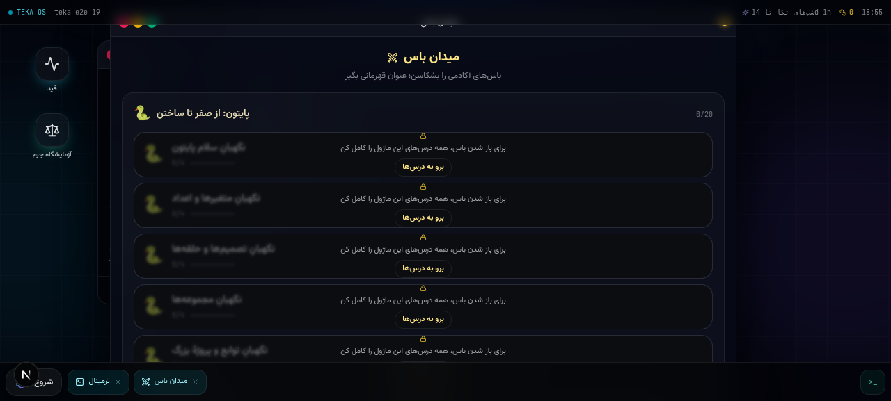

<div align="center">

# ⚡ TEKA NEXUS

### *Where ideas become real technology.*

**A developer-first social platform · a free 300-lesson coding academy · an arena of 12 game modules — in one installable PWA.**

[](https://nextjs.org)
[](https://www.typescriptlang.org)
[](https://tailwindcss.com)
[](https://www.prisma.io)
[](https://supabase.com)
[](https://developer.mozilla.org/docs/Web/Progressive_web_apps)
[](#internationalization)

[Live Platform](https://teka-nexus.vercel.app/) · [GitHub](https://github.com/mhmdsdqi87-cloud) · [Contact](mailto:mhmdsdqi87@gmail.com)

</div>

---

## 👤 About the maker

> **TEKA NEXUS was designed, engineered, tested and operated end-to-end by one person — not out of pride, but out of necessity: there was no one else.**

| | |
|---|---|
| **Author** | **Mohammad Sadeghi** (محمد صادقی) |
| **Role** | Founder · Self-taught Full-Stack Developer · Product Designer |
| **GitHub** | <https://github.com/mhmdsdqi87-cloud> |
| **Email** | <mailto:mhmdsdqi87@gmail.com> |

There was no teacher to ask at 2 AM, no team to share the weight with, no degree
to open doors — only the internet, long nights and more stubbornness than
credentials. So every layer of this product — the UX language, the 45-model
database schema, four auto-grading code engines, 300 lessons of bilingual
course content, an arena of 12 game modules, and seven fully localized
interfaces — was learned and built the only way its maker knows: by building,
breaking, and rebuilding until it finally works.

> 🎓 *This repository serves as a living portfolio — not proof of knowing, but
> evidence of wanting. I am open to academic and professional opportunities —
> feel free to reach out.*
>
> 🇷🇺 *I am a self-taught developer with no degree — yet. What I have instead:
> nights, mistakes, and a platform that actually works. **My dream is to
> continue my education in Russia**, and TEKA NEXUS is my quiet letter of
> intent. The letter itself — written in Russian, humble and honest — lives in
> the platform's About page («В надежде на учёбу в России»).*

---

## 🌍 What is TEKA NEXUS?

TEKA NEXUS started with one question: **why should learning to code be hard?**

It is a complete ecosystem that blends **networking, building and learning** into a
single seamless experience — not a course site with a forum bolted on, but a
**social arena** for the next generation of Iranian (and global) developers:

| Pillar | What it delivers |
|---|---|
| 🧭 **Discover** | A real technology feed — projects, builders, verified reputation earned by *actions*, not clicks |
| 🤝 **Build** | Project workspaces: kanban tasks, milestones, threaded comments, collaboration requests, **real-time team chat** (socket.io) |
| 🎓 **Learn** | A free-forever academy: 300 hands-on lessons, in-browser Python, live HTML/CSS preview, auto-graded challenges, proctored certification |
| 🏆 **Arena** | 12 game modules promoted to first-class views in the main navigation — Boss Fights, Skill Tree, Code Pet, Cards, Red-vs-Blue War, and more |
| 🎮 **Play** | XP economy, collectible cards, speedruns, monthly TEKA Nights — a small game economy to keep you coming back |

<div align="center">
  
  <p><sub>TEKA Arena — every module is a full-screen, first-class destination.</sub></p>
</div>

---

## 🏆 TEKA Arena — the game layer

The old desktop shell is gone — every module now lives **directly in the main
navigation bar**, one click away at all times. No windows, no metafloor: each
game is a first-class, full-screen experience:

```
help · apps · open <app> · status · whoami · neofetch · date · echo
matrix [on|off] · clear
teka learn <course>     # jump straight into a course
teka <app>              # open any arena module by name (teka boss, teka pet …)
battle @user            # challenge someone (for glory)
…and maybe one secret. maybe.
```

- 🟢 **Matrix mode** — full-screen falling code overlay (`Ctrl+Shift+M`)
- 🌌 **TEKA NIGHTS strip** — live countdown to the next monthly event, red-alert theming when it's live
- 🔗 **Deep links** — `teka learn css` opens the academy scrolled to the CSS course
- 🗺️ **Arena Hub** — a launcher grid with all 12 modules, records and stats

<details>
<summary><b>The 12 Arena modules</b></summary>

| App | What it does |
|---|---|
| 🗺️ **Skill Tree** | Galaxy-map progression — nodes unlock as you complete prerequisites |
| ⚔️ **Boss Fight** | A boss at the end of every course: correct answers deal damage, mistakes hurt you. Beat the final boss → earn a title like *“Python Slayer”* |
| 🐣 **Code Pet** | An egg that hatches and evolves as you learn. Skip 3 days and it gets hungry — a streak system that holds a gentle grudge |
| 🔴🔵 **Red vs Blue War** | Pick a side at signup; weekly war events with live team scoring |
| 🃏 **Coder Cards** | Collectible profile cards with unique serial numbers and rarities (Legendary cards for boss slayers & 100-day streaks) |
| 🪙 **Shop** | Spend TEKA Coins on profile frames, boosts and card packs |
| 🕵️ **Crime Scene** | Digital forensics mini-games: analyze logs, trace IPs, close the case |
| ⏱️ **Speedrun** | Global module timers with a record board |
| ⏳ **Time Machine** | Animated replay of your entire learning journey |
| 🔥 **Heatmap** | GitHub-style daily activity grid |
| 🎙️ **Voice Rooms** | Topic rooms with AI-narrated messages (server-side TTS) |
| ⌨️ **Terminal** | A real shell with live commands: `teka boss`, `matrix on`, `neofetch`, one secret easter egg |

</details>

---

## 🎓 TEKA Academy — 300 lessons, zero setup

Four tracks, each engineered around **doing**, not watching:

| Track | Lessons | Engine |
|---|---|---|
| 🐍 **Python** | 76 | Custom **pylite interpreter** — a Python subset that runs entirely in the browser (variables, control flow, functions, loops, lists, dicts, strings) |
| 🌐 **HTML** | 73 | Live preview + **DOM assertions** (element presence, text, nesting, attributes) |
| 🎨 **CSS** | 81 | Live preview + **computed-style grading** (`display: flex` etc. verified against the rendered DOM) |
| ⚡ **JavaScript** | 70 | Sandboxed iframe runtime with **synchronous deterministic tests** (no fetch/timers/random in challenges) |

**300 lessons total** — every one bilingual, compact and practical.

Every lesson follows the same pedagogy: **2 theory steps → quiz → auto-graded challenge**
(starter code, solution, 3 progressive hints).

Plus the **Learning Portal**: learning paths, Bug Detective, Error Encyclopedia,
Predict-the-Output, a bilingual glossary, per-lesson notes, bookmarks, daily streak,
12 achievements, a Ctrl+K lesson explorer with full-text search & filters, and a
**Socratic AI Tutor** (server-side LLM — keys never touch the client).

### 🏅 Official TEKA License
A **proctored final exam** (15 minutes, server-graded, max 3 attempts, server-side
anti-cheat) → a verifiable license certificate with a unique ID per track.

---

## ✨ Feature tour

<details open>
<summary><b>Social & collaboration</b></summary>

- Posts, likes, comments, reposts, bookmarks, hashtag search
- Follow / block / mute, granular notifications (in-app + badge counts)
- Direct messages with read state
- Project workspaces: kanban tasks, milestones, updates, file links
- Real-time **team chat** via a dedicated socket.io mini-service (presence, typing, reactions, history)
- Collaboration requests with role negotiation (contributor / viewer)
- GitHub integration: repo panels, community contributors
- Founder console: live community stats + member management (role-gated)

</details>

<details>
<summary><b>Authentication & security</b></summary>

- Email/password with **scrypt** hashing (per-user salt, `timingSafeEqual`)
- **Google OAuth 2.0** full flow (status probe → start → callback → account link by email)
- httpOnly session cookies, 30-day server-side sessions (Session table)
- All 60+ REST endpoints zod-validated; authorization checked per-request server-side
- Anti-cheat for exams and speedruns enforced **server-side**
- AI & TTS proxied through server routes only — no key ever reaches the browser

</details>

<details>
<summary><b>Experience & platform</b></summary>

- **Cinematic boot sequence**: neural-network canvas, orbital rings, terminal boot log (≈8s, respects `prefers-reduced-motion`)
- **Glassmorphism** design language: layered blur, neon accents, spring physics (framer-motion)
- **PWA**: installable, brand-rendered icons, safe service worker (production-only)
- Full **RTL support** for Persian & Arabic (direction-aware components)
- GitHub-style heatmap, streaks, animated stat counters, toast system, skeletons everywhere

</details>

---

## 🏗️ Architecture

```text
┌────────────────────────────────────────────────────────────────────┐
│                        Browser (PWA client)                        │
│  Next.js 16 App Router SPA — zustand router, framer-motion, 7 i18n │
│  TEKA Arena · pylite interpreter · sandboxed iframes               │
└──────────────────────────────┬─────────────────────────────────────┘
                               │  REST (zod-validated, session cookie)
┌──────────────────────────────▼─────────────────────────────────────┐
│                     Next.js API routes (60+)                       │
│  auth · social · projects · academy · exam · arena (12 modules) · tts│
│  server-side grading · anti-cheat · LLM proxy (keys stay server)   │
└───────────────┬────────────────────────────────┬───────────────────┘
                │ Prisma ORM                     │ socket.io client
┌───────────────▼────────────────┐  ┌────────────▼───────────────────┐
│   PostgreSQL (Supabase)        │  │  mini-services/chat-service    │
│   30+ models: User, Post,      │  │  dedicated Bun process, own    │
│   Project, Task, Session,      │  │  port & package.json — real-   │
│   License, War*, Pet*, Card*,  │  │  time team chat (rooms, pres-  │
│   Speedrun*, Activity …        │  │  ence, typing, reactions)      │
└────────────────────────────────┘  └────────────────────────────────┘
```

### Tech stack

| Layer | Choice | Why |
|---|---|---|
| Framework | **Next.js 16** (App Router, standalone output) | RSC-ready SPA shell, one deploy target |
| Language | **TypeScript 5**, strict | End-to-end type safety, 7-locale typed dictionaries |
| Styling | **Tailwind CSS 4** + shadcn/ui + Lucide | Consistent glass/neon design system |
| Motion | framer-motion | Spring physics, page transitions, arena effects |
| DB | **Prisma ORM** → PostgreSQL (Supabase prod / SQLite dev) | Typed schema, 30+ models, zero SQL drift |
| Realtime | socket.io mini-service (Bun) | Isolated scaling + crash domain for chat |
| AI | Server-side LLM tutor + TTS narration | Personalized help, audio lessons |
| Hosting | Vercel (frontend+API) · Supabase (DB) | CI/CD on push, zero-ops |

---

## 🌐 Internationalization

**English · فارسی · العربية · Español · Français · Русский · 中文** — typed
dictionaries, locale-aware dates & numbers, full RTL mirroring for Persian &
Arabic, browser-language detection with persistence. Russian (🇷🇺 Русский)
joined as the seventh locale — the language of the universities this project
is addressed to.

---

## 🚀 Quick start

```bash
# 1. install
bun install                        # or: npm / pnpm / yarn

# 2. environment
cp .env.example .env               # SQLite works out of the box for local dev
#   DATABASE_URL="file:./db/custom.db"          ← dev default
#   For Supabase Postgres see docs/SUPABASE.md

# 3. schema
bun run db:push

# 4. run
bun run dev                        # http://localhost:3000

# 4b. real-time chat service (optional, separate terminal)
cd mini-services/chat-service && bun run dev
```

> 📦 **Production**: Vercel + Supabase — full runbook in [`docs/DEPLOY.md`](docs/DEPLOY.md)
> (including Android AAB packaging via TWA for app stores).

---

## 📁 Repository map

```text
src/
  app/                  # "/" SPA shell + /api/** route handlers (REST, zod)
    api/auth/           #   session + Google OAuth (status/start/callback)
    api/academy/        #   grading, exam, tutor
    api/arena/          #   12 arena module backends (boss, pet, war, cards, …)
  views/                # one client view per product area (SPA router = zustand)
  components/
    os/                 # TEKA Arena: terminal, matrix, 12 game modules
    academy/            # lesson player, explorer, achievements
    landing/ auth/ shell/ shared/ pulse/ project/
  lib/
    academy/            # course data + pylite interpreter + exam engine
    os/                 # economy, boss/tree/war logic, session store, strings
    i18n/               # 7 typed locales (fa en ar es fr ru zh)
mini-services/          # socket.io chat service (own port, own package.json)
docs/                   # API contract, deploy, Supabase, SEO, OAuth guides
```

---

## ✅ Honest status

**Implemented & end-to-end browser-tested:** auth + onboarding, TEKA Arena (terminal
with live commands, matrix mode, all 12 modules as first-class main-nav views),
academy 300 lessons with auto-grading (Python interpreter, HTML/CSS/JS engines),
proctored exam → license, social feed/projects/tasks/milestones/team chat/DM/notifications,
XP + coins + cards + war + pet economy, heatmap + time machine + speedrun,
AI tutor + TTS, 7 locales, PWA, Google OAuth.

**Known trade-offs:** sockets for chat run as a separate mini-service (by design);
voice rooms use AI narration clips rather than full WebRTC audio (deliberate scope cut);
the desktop window manager was retired on purpose — every module deserves the full screen.

---

## 🗺️ Roadmap

- [ ] **Hack Zone** — CTF-style security challenges with a hacker rank ladder
- [ ] WebRTC audio in Voice Rooms (live voice, not just narration)
- [ ] Season-based leaderboards with placement rewards
- [ ] Code Battle — 1v1 live duels on the same problem
- [ ] More tracks: Git, SQL, React, and a full **Security** curriculum
- [ ] 🇷🇺 Russian scholarship chapter — adapt TEKA NEXUS into a bilingual (ru/en) admissions dossier for Russian universities

---

## 📜 License & credits

Built with stubborn hope — and more nights than sleep — by **Mohammad Sadeghi**.
All product naming, design language and course content © 2025 Mohammad Sadeghi.

<div align="center">
  <sub>⭐ If this project inspires you, a star on GitHub means a lot.</sub><br>
  <a href="https://github.com/mhmdsdqi87-cloud">GitHub</a> · <a href="mailto:mhmdsdqi87@gmail.com">mhmdsdqi87@gmail.com</a>
</div>
