**English** · [فارسی](README.fa.md) · [العربية](README.ar.md) · [Español](README.es.md) · [Français](README.fr.md) · [Русский](README.ru.md) · [中文](README.zh.md)

<div align="center">


<a href="https://teka-nexus.vercel.app/">
  
</a>

<br>

[](https://teka-nexus.vercel.app/)
[](https://nextjs.org)
[](https://www.typescriptlang.org)
[](https://developer.mozilla.org/docs/Web/Progressive_web_apps)
[](LICENSE)

<br>

[](https://github.com/mhmdsdqi87-cloud/TEKA-NEXUS/releases)
[](https://github.com/mhmdsdqi87-cloud/TEKA-NEXUS/stargazers)
[](https://github.com/mhmdsdqi87-cloud/TEKA-NEXUS/forks)
[](https://github.com/mhmdsdqi87-cloud/TEKA-NEXUS/issues)
[](https://github.com/mhmdsdqi87-cloud/TEKA-NEXUS/commits/main)
[](https://github.com/mhmdsdqi87-cloud/TEKA-NEXUS)
[](#internationalization)

<br>

[🚀 Live Platform](https://teka-nexus.vercel.app/) · [📱 Android APK](https://github.com/mhmdsdqi87-cloud/TEKA-NEXUS/releases/tag/myket-v1.0.2) · [🤝 Contributing](CONTRIBUTING.md) · [🐛 Issues](https://github.com/mhmdsdqi87-cloud/TEKA-NEXUS/issues) · [👤 GitHub](https://github.com/mhmdsdqi87-cloud) · [✉️ Contact](mailto:mhmdsdqi87@gmail.com)

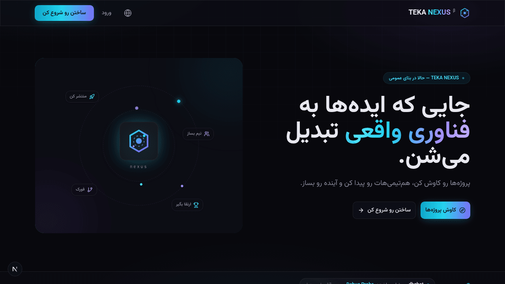

<sub><b>Social feed · free 300-lesson academy · 12 arena modules · Live Universe · Project DNA — 7 languages, one platform.</b></sub>

</div>


## 👤 Built by one human

> **TEKA NEXUS was designed, engineered, tested and operated end-to-end by one person — not out of pride, but out of necessity: there was no one else.**

| | |
|---|---|
| **Author** | **Mohammad Sadeghi** (محمد صادقی) |
| **Role** | Founder · Self-taught Full-Stack Developer · Product Designer |
| **GitHub** | <https://github.com/mhmdsdqi87-cloud> |
| **Email** | <mailto:mhmdsdqi87@gmail.com> |

There was no teacher to ask at 2 AM, no team to share the weight with, no degree
to open doors — only the internet, long nights and more stubbornness than
credentials. Every layer of this product — the UX language, the 45-model database
schema, four auto-grading code engines, 300 lessons of bilingual course content,
an arena of 12 game modules, and seven fully localized interfaces — was learned
the only way its maker knows: by building, breaking, and rebuilding until it works.

> 🎓 *This repository is a living portfolio — not proof of knowing, but evidence
> of wanting. Open to academic and professional opportunities.*
>
> 🇷🇺 *My dream is to continue my education in Russia. The letter itself —
> written in Russian, humble and honest — lives on the platform's About page
> («В надежде на учёбу в России»).*


## 🌍 What is TEKA NEXUS?

<div align="center">


</div>

TEKA NEXUS started with one question: **why should learning to code be hard?**

It is a complete ecosystem that blends **networking, building and learning**
into one seamless, installable experience — not a course site with a forum
bolted on, but a **social arena** for the next generation of developers,
Persian-first, open to the world.

<div align="center">

| | | |
|:---:|:---:|:---:|
| 🧭 **Discover**<br><sub>A real tech feed — projects, builders, reputation earned by *actions*</sub> | 🤝 **Build**<br><sub>Project workspaces: kanban, milestones, **real-time team chat**</sub> | 🎓 **Learn**<br><sub>300 hands-on lessons, in-browser Python, auto-graded challenges</sub> |
| 🏆 **Arena**<br><sub>12 game modules as first-class views in the main nav</sub> | 🌌 **Live Universe**<br><sub>A 3D globe of real community data — no fake numbers, ever</sub> | 🧬 **Project DNA**<br><sub>A verified digital identity for every project</sub> |
| 🎮 **Play**<br><sub>XP economy, collectible cards, streaks, monthly TEKA Nights</sub> | 🔐 **Secure**<br><sub>scrypt auth, zod-validated APIs, server-side anti-cheat</sub> | 🌐 **Speak**<br><sub>7 full locales with true RTL for Persian & Arabic</sub> |

</div>

<details>
<summary><b>🖼️ Feel the product — gallery</b></summary>

<div align="center">

| Arena Boss Fight | Skill Tree | Code Pet |
|:---:|:---:|:---:|
| 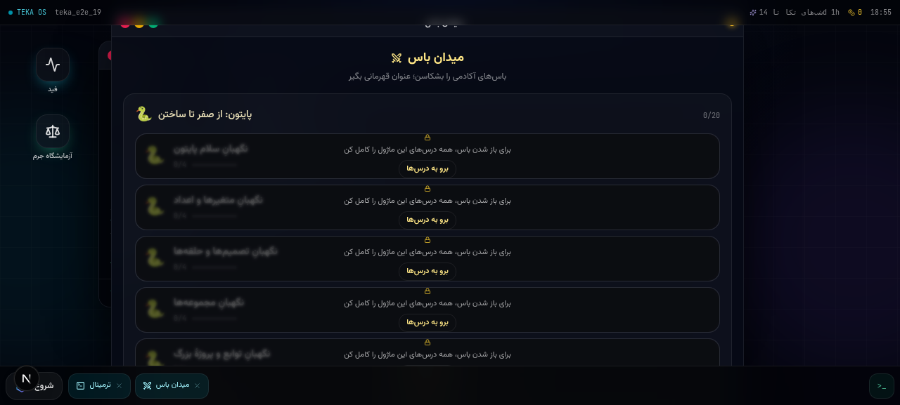 | 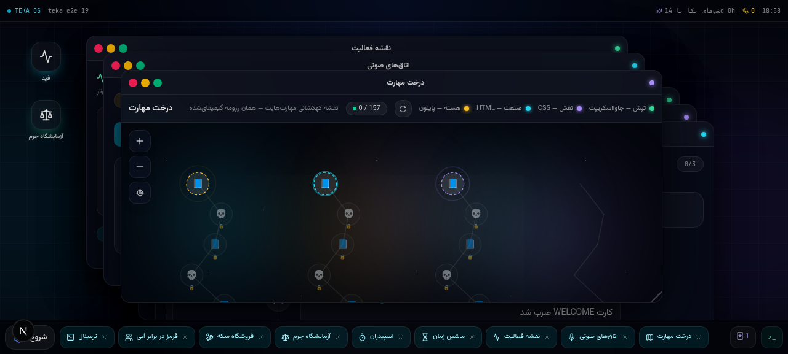 | 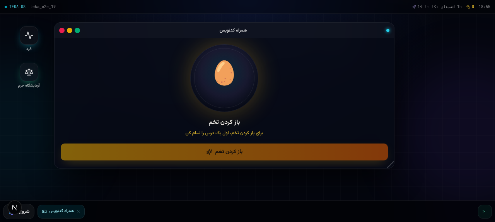 |

| Coder Cards | Matrix Mode | Terminal |
|:---:|:---:|:---:|
| 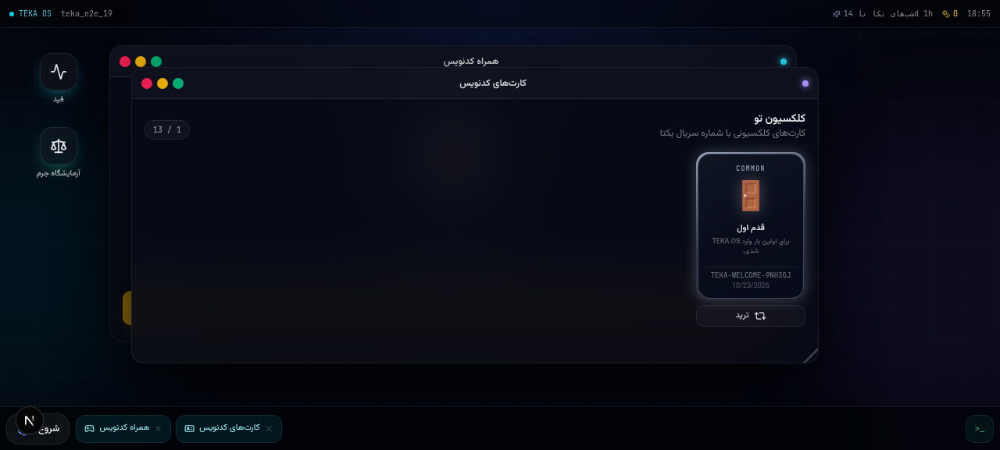 | 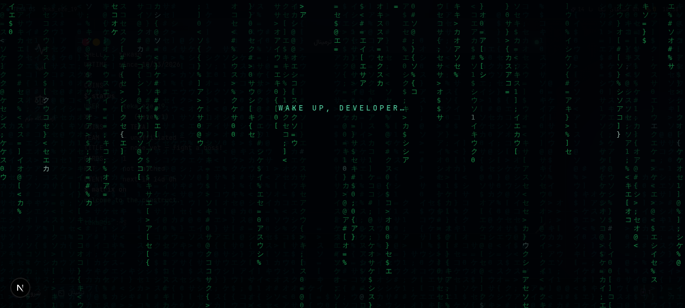 | 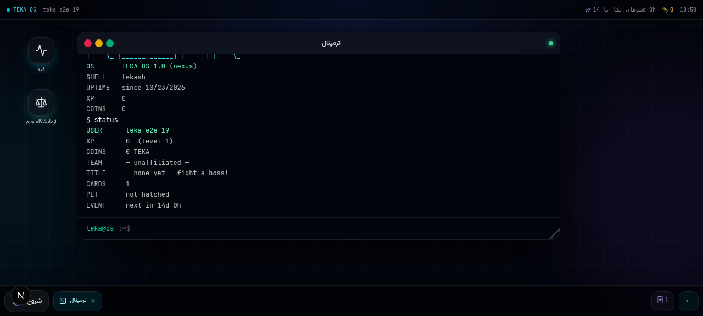 |

</div>

</details>


## 🧬 The Global Engine — eight systems, one nexus

<div align="center">


</div>

The next generation of TEKA NEXUS is an **eight-system expansion** — and the
build log is public, commit by commit:

| # | System | Status |
|:---:|---|---|
| 1 | 🌌 **Live Universe** — a WebGL 3D globe rendering *real* community aggregates via `/api/universe` | ✅ **Shipped** — `v1.74.0` |
| 2 | 🧬 **Project DNA** — a verified digital identity & history for every project | ✅ **Shipped** — `v1.75.0` |
| 3 | 🤖 **AI Autonomous Studio** — six specialized agents with human approval checkpoints | 🚧 Planned |
| 4 | ⚔️ **War Room** — permanent decision records: context, options, verdicts | 🚧 Planned |
| 5 | 🧠 **Code Intelligence** — GitHub *OAuth-only* repo intelligence; never passwords, never untrusted code execution | 🚧 Planned |
| 6 | 🏅 **Global Challenges** — judged engineering competitions | 🚧 Planned |
| 7 | 🕸️ **Knowledge Graph** — semantic search over real indexed data | 🚧 Planned |
| 8 | 👯 **Digital Twin** — telemetry that is always labeled: *actual / calculated / simulated / AI-predicted* | 🚧 Planned |

<div align="center">


</div>

> ⚠️ **Integrity rule of the house:** we never present estimates as facts, never
> ship mock data as real information, and never mark anything "done" that
> wasn't tested end-to-end. What you see checked above is exactly what exists.


## 🎓 TEKA Academy — 300 lessons, zero setup

Four tracks, each engineered around **doing**, not watching:

| Track | Lessons | Engine |
|---|:---:|---|
| 🐍 **Python** | 76 | Custom **pylite interpreter** — a Python subset running entirely in the browser |
| 🌐 **HTML** | 73 | Live preview + **DOM assertions** |
| 🎨 **CSS** | 81 | Live preview + **computed-style grading** against the rendered DOM |
| ⚡ **JavaScript** | 70 | Sandboxed iframe runtime with **deterministic tests** |

**300 lessons total** — every one bilingual, compact, practical. Pedagogy:
**2 theory steps → quiz → auto-graded challenge** (starter code, solution,
3 progressive hints).

Plus the **Learning Portal**: learning paths, Bug Detective, Error Encyclopedia,
Predict-the-Output, bilingual glossary, bookmarks, daily streak, 12 achievements,
a `Ctrl+K` explorer with full-text search, and a **Socratic AI Tutor** (server-side
LLM — keys never touch the client).

### 🏅 Official TEKA License
A **proctored final exam** (15 minutes, server-graded, max 3 attempts, server-side
anti-cheat) → a verifiable certificate with a unique ID per track.

## 🏆 TEKA Arena — the game layer

Every module lives **directly in the main navigation bar** — no windows, no
metafloor, each game a first-class, full-screen experience:

- 🟢 **Matrix mode** — full-screen falling code overlay (`Ctrl+Shift+M`)
- 🌌 **TEKA NIGHTS strip** — live countdown to the next monthly event
- 🔗 **Deep links** — `teka learn css` opens the academy at the CSS course
- ⌨️ **Terminal** — a real shell: `teka boss`, `matrix on`, `neofetch`… and one secret

<details>
<summary><b>The 12 Arena modules</b></summary>

| App | What it does |
|---|---|
| 🗺️ **Skill Tree** | Galaxy-map progression — nodes unlock as prerequisites complete |
| ⚔️ **Boss Fight** | A boss at the end of every course; beat it → earn titles like *“Python Slayer”* |
| 🐣 **Code Pet** | An egg that hatches as you learn; skip 3 days and it gets hungry |
| 🔴🔵 **Red vs Blue War** | Pick a side at signup; weekly wars with live team scoring |
| 🃏 **Coder Cards** | Collectible cards with serial numbers & rarities |
| 🪙 **Shop** | Spend TEKA Coins on frames, boosts, card packs |
| 🕵️ **Crime Scene** | Digital forensics mini-games: logs, IPs, close the case |
| ⏱️ **Speedrun** | Global module timers with a record board |
| ⏳ **Time Machine** | Animated replay of your entire learning journey |
| 🔥 **Heatmap** | GitHub-style daily activity grid |
| 🎙️ **Voice Rooms** | Topic rooms with AI-narrated messages (server-side TTS) |
| ⌨️ **Terminal** | A real shell with live commands |

</details>

## ✨ Feature tour

<details open>
<summary><b>Social & collaboration</b></summary>

- Posts, likes, comments, reposts, bookmarks, hashtag search
- Follow / block / mute, granular notifications (in-app + badge counts)
- Direct messages with read state
- Project workspaces: kanban tasks, milestones, updates, file links
- Real-time **team chat** via a dedicated socket.io mini-service (presence, typing, reactions, history)
- Collaboration requests with role negotiation (contributor / viewer)
- GitHub integration: repo panels, community contributors
- Founder console: live community stats + member management (role-gated)

</details>

<details>
<summary><b>Authentication & security</b></summary>

- Email/password with **scrypt** hashing (per-user salt, `timingSafeEqual`)
- httpOnly session cookies, 30-day server-side sessions
- All 60+ REST endpoints zod-validated; authorization checked per-request server-side
- Anti-cheat for exams and speedruns enforced **server-side**
- AI & TTS proxied through server routes only — no key ever reaches the browser

</details>

<details>
<summary><b>Experience & platform</b></summary>

- **Cinematic boot sequence**: neural-network canvas, orbital rings, terminal boot log (≈8s, respects `prefers-reduced-motion`)
- **Glassmorphism** design language: layered blur, neon accents, spring physics (framer-motion)
- **PWA**: installable, brand-rendered icons, safe service worker (production-only)
- Full **RTL support** for Persian & Arabic (direction-aware components)
- GitHub-style heatmap, streaks, animated stat counters, toast system, skeletons everywhere

</details>


## 🏗️ Architecture

```text
┌────────────────────────────────────────────────────────────────────┐
│                        Browser (PWA client)                        │
│  Next.js 16 App Router SPA — zustand router, framer-motion, 7 i18n │
│  TEKA Arena · pylite interpreter · sandboxed iframes               │
└──────────────────────────────┬─────────────────────────────────────┘
                               │  REST (zod-validated, session cookie)
┌──────────────────────────────▼─────────────────────────────────────┐
│                     Next.js API routes (60+)                       │
│  auth · social · projects · academy · exam · arena (12 modules) ·  │
│  universe · dna · tts · server-side grading · anti-cheat · LLM proxy│
└───────────────┬────────────────────────────────┬───────────────────┘
                │ Prisma ORM                     │ socket.io client
┌───────────────▼────────────────┐  ┌────────────▼───────────────────┐
│   PostgreSQL (Supabase)        │  │  mini-services/chat-service    │
│   30+ models: User, Post,      │  │  dedicated Bun process, own    │
│   Project, Task, Session,      │  │  port & package.json — real-   │
│   License, War*, Pet*, Card*,  │  │  time team chat (rooms, pres-  │
│   Speedrun*, Activity …        │  │  ence, typing, reactions)      │
└────────────────────────────────┘  └────────────────────────────────┘
```

### Tech stack

<div align="center">
  <a href="https://skillicons.dev">
    
  </a>
</div>

| Layer | Choice | Why |
|---|---|---|
| Framework | **Next.js 16** (App Router, standalone output) | RSC-ready SPA shell, one deploy target |
| Language | **TypeScript 5**, strict | End-to-end type safety, 7-locale typed dictionaries |
| Styling | **Tailwind CSS 4** + shadcn/ui + Lucide | Consistent glass/neon design system |
| Motion | framer-motion | Spring physics, page transitions, arena effects |
| DB | **Prisma ORM** → PostgreSQL (Supabase prod / SQLite dev) | Typed schema, 30+ models, zero SQL drift |
| Realtime | socket.io mini-service (Bun) | Isolated scaling + crash domain for chat |
| AI | Server-side LLM tutor + TTS narration | Personalized help, audio lessons |
| Hosting | Vercel (frontend+API) · Supabase (DB) | CI/CD on push, zero-ops |

## 🌐 Internationalization

<div align="center">

**English** 🇬🇧 · فارسی 🇮🇷 · العربية 🇸🇦 · Español 🇪🇸 · Français 🇫🇷 · Русский 🇷🇺 · 中文 🇨🇳

</div>

Typed dictionaries, locale-aware dates & numbers, full RTL mirroring for
Persian & Arabic, browser-language detection with persistence. This README
speaks all seven too — switch at the very top. ⬆️


## 🚀 Quick start

```bash
# 1. install
bun install                        # or: npm / pnpm / yarn

# 2. environment
cp .env.example .env               # SQLite works out of the box for local dev
#   DATABASE_URL="file:./db/custom.db"          ← dev default
#   For Supabase Postgres see docs/SUPABASE.md

# 3. schema
bun run db:push

# 4. run
bun run dev                        # http://localhost:3000

# 4b. real-time chat service (optional, separate terminal)
cd mini-services/chat-service && bun run dev
```

> 📦 **Production**: Vercel + Supabase — full runbook in [`docs/DEPLOY.md`](docs/DEPLOY.md)
> (including Android AAB packaging via TWA for app stores).

## 🗺️ Roadmap

- [x] 🌌 **Live Universe** — real-data WebGL globe (`v1.74.0`)
- [x] 🧬 **Project DNA** — verified project identity (`v1.75.0`)
- [x] 📚 **NEXUS Library** — verified reference implementations + public Knowledge API + MCP server + llms.txt
- [ ] 🤖 **AI Autonomous Studio** — 6 agents, human approval checkpoints
- [ ] ⚔️ **War Room** — decision records
- [ ] 🧠 **Code Intelligence** — GitHub OAuth-only repo intelligence
- [ ] 🏅 **Global Challenges** — judged competitions
- [ ] 🕸️ **Knowledge Graph** — semantic search
- [ ] 👯 **Digital Twin** — labeled telemetry
- [ ] **Hack Zone** — CTF-style security challenges with a hacker rank ladder
- [ ] WebRTC audio in Voice Rooms · season leaderboards · Code Battle 1v1 duels
- [ ] More tracks: Git, SQL, React, full **Security** curriculum
- [ ] 🇷🇺 Russian scholarship chapter — bilingual (ru/en) admissions dossier

## 🧾 Build log

Engineering session notes — what was recently built, fixed, and verified.

### 2026-11 · reliability, hygiene, deployment pipeline

- **Browser-verified end-to-end** — every product view (Home, Explore, Projects, Workspace, Academy portal, Live Universe, Project DNA, the full Arena family, Skill Tree, Code Pet, Coder Cards, Red vs Blue, Coin Shop, Teams, Notifications, Messages, Saved, Live) loads with **zero page errors**; the whole user journey was exercised live: registration → 4-step onboarding → academy lesson playback → project publish → project workspace.
- **Repo hygiene ([#18](https://github.com/mhmdsdqi87-cloud/TEKA-NEXUS/pull/18))** — removed three one-off debug scripts (`.tmp-*.ts`), untracked local sandbox tooling (`.zscripts/`), and hardened `.gitignore` (`.tmp-*`, `.zscripts/`) so local artifacts can never be committed again.
- **Deployment pipeline hardening** — a project-level *Ignored Build Step* on Vercel skips the assets-only `output` branch; bot commits carry skip keywords; background builds no longer produce failed-deployment noise.
- **Function Storage cleanup** — 163 stale/failed deployments removed across all projects (183 → 20); all six live sites verified serving `200` afterwards.
- **Community space** — Discussions enabled: an architecture reference ([#19](https://github.com/mhmdsdqi87-cloud/TEKA-NEXUS/discussions/19)) and a public roadmap thread ([#20](https://github.com/mhmdsdqi87-cloud/TEKA-NEXUS/discussions/20)). Questions welcome in Q&A.

### 2026-11 · Knowledge Library: catalog resilience + builder expansion

- **Catalog fallback ([#26](https://github.com/mhmdsdqi87-cloud/TEKA-NEXUS/pull/26))** — the Library API and `llms.txt` answered `internal error` in production because the `LibraryEntry` table had not been pushed to the production Postgres yet. All three endpoints now fall back to the seed catalog with identical shapes and identical search semantics, honest `draft` labels, and `meta.source: "catalog"` — a fresh deployment works before anyone touches the database.
- **Builder expansion** — 4 new entries distilled from the platform's own code, each pipeline-verified: [`boot-env-guard`](scripts/library-entries.ts) (from the boot guard in `next.config.ts`), `sandboxed-demo-verifier` (from `scripts/library-verify.ts`), `idempotent-seed-upsert` (from `scripts/library-seed.ts`), and `db-singleton-client` (from `src/lib/db.ts`). Builders now reuse the exact patterns TEKA NEXUS itself runs on.
- **Pipeline proof** — 15 entries verified by real execution, 0 failed, 1 honestly stays `draft` (no runnable demo). The pipeline even caught an escaping bug in a new entry before merge — statuses are computed, never claimed.
- **Builders guide** — [`docs/NEXUS-LIBRARY.md`](docs/NEXUS-LIBRARY.md) gained a "For builders" section: copy an entry, call the API, or plug your AI agent in via `llms.txt` / MCP.

## 🤝 Contributing

This project is built by one person — **contributions are not just welcome, they are the future**.

| Way in | Start here |
|---|---|
| 💻 Code | [`CONTRIBUTING.md`](CONTRIBUTING.md) → pick an issue → PR |
| 🌍 Translation | Improve any of the 7 locales in `src/lib/i18n/` or translate docs |
| 🎓 Content | Propose lessons or challenge ideas for the academy |
| 🐛 Bug hunts | Report in [Issues](https://github.com/mhmdsdqi87-cloud/TEKA-NEXUS/issues) — repro steps win hearts |
| ⭐ Support | Star the repo, share it with one friend who's learning to code |

Read our [Code of Conduct](CODE_OF_CONDUCT.md). Questions and support → [`SUPPORT.md`](SUPPORT.md). Security issues → [`SECURITY.md`](SECURITY.md) (responsible disclosure). Cite the project via [`CITATION.cff`](CITATION.cff).


## 📊 Repository metrics

<!-- TEKA:METRICS:START -->
| 👀 Visitors (14d) | 📄 Views (14d) | 🧬 Cloners (14d) | 📥 Clones (14d) | ⭐ Stars | 🍴 Forks | 🐞 Open issues |
|---:|---:|---:|---:|---:|---:|---:|
| 9 | 52 | 261 | 638 | 3 | 0 | 0 |

<sub>Real numbers from GitHub's own API · auto-refreshed daily · last update 2026-11-13 11:13 UTC · nothing sampled, nothing invented.</sub>
<!-- TEKA:METRICS:END -->

<div align="center">

<a href="https://github.com/mhmdsdqi87-cloud/TEKA-NEXUS">
  
</a>
<a href="https://github.com/mhmdsdqi87-cloud/TEKA-NEXUS">
  
</a>

<a href="https://github.com/mhmdsdqi87-cloud/TEKA-NEXUS">
  
</a>


<picture>
  <source media="(prefers-color-scheme: dark)" srcset="https://raw.githubusercontent.com/mhmdsdqi87-cloud/TEKA-NEXUS/output/github-contribution-grid-snake-dark.svg">
  <source media="(prefers-color-scheme: light)" srcset="https://raw.githubusercontent.com/mhmdsdqi87-cloud/TEKA-NEXUS/output/github-contribution-grid-snake.svg">
  
</picture>

<picture>
  <source media="(prefers-color-scheme: dark)" srcset="https://api.star-history.com/svg?repos=mhmdsdqi87-cloud/TEKA-NEXUS&type=Date&theme=dark">
  <source media="(prefers-color-scheme: light)" srcset="https://api.star-history.com/svg?repos=mhmdsdqi87-cloud/TEKA-NEXUS&type=Date">
  
</picture>

</div>


## 🛠️ Repository infrastructure — shipped & verified

Everything below is live in this repo **right now** — nothing on this list is aspirational. If any row ever goes stale, that's a bug: open an issue and we'll fix it the same day.

| System | Status | What it does |
|---|---|---|
| 📊 Real-metrics pipeline | ✅ built | Daily cron refreshes the metrics block above from GitHub's own API — stars, forks, open issues, plus real 14-day views & clones via a scoped `TRAFFIC_TOKEN` secret |
| 🐍 Contribution snake | ✅ built | [`snake.yml`](.github/workflows/snake.yml) draws the eat-the-graph animation daily onto the `output` branch |
| 🤝 Welcome workflow | ✅ built | [`welcome.yml`](.github/workflows/welcome.yml) greets every first-time issue author and contributor |
| 🤖 Dependabot | ✅ built | Monthly freshness for GitHub Actions — first bump already merged |
| 💬 Discussions | ✅ built | Q&A · Ideas · Announcements categories open for every visitor — real answers, marked accepted |
| 🧭 Community docs | ✅ built | [`SUPPORT.md`](SUPPORT.md) · [`CODEOWNERS`](.github/CODEOWNERS) · [`CITATION.cff`](CITATION.cff) · issue templates · categorized release notes |
| 🖼️ Social preview | ✅ built | [`public/og.png`](public/og.png) (1440×736) ships with the repo — one click away in Settings → Social preview |
| 🚀 Release pipeline | ✅ built | Tag-driven releases with categorized notes — v1.75.0 shipped |

<sub>Verified 2026-11-13 · every number in this README comes from GitHub's own counters — nothing sampled, nothing invented.</sub>

## 📜 License & credits

Built with stubborn hope — and more nights than sleep — by **Mohammad Sadeghi**.
All product naming, design language and course content © 2025-2026 Mohammad Sadeghi.
Released under the [MIT License](LICENSE).

📘 Release history: [CHANGELOG.md](CHANGELOG.md) · 🗺️ Deep roadmap: [docs/ROADMAP.md](docs/ROADMAP.md)

---

<div align="center">


<sub><i>Designed · engineered · tested · operated by one person. Open to everyone.</i></sub>


⭐ **If this project inspires you, a star means the world to a solo builder.**

<a href="https://github.com/mhmdsdqi87-cloud">GitHub</a> · <a href="https://teka-nexus.vercel.app/">Live Platform</a> · <a href="mailto:mhmdsdqi87@gmail.com">mhmdsdqi87@gmail.com</a>

</div>
