[English](README.md) · [فارسی](README.fa.md) · [العربية](README.ar.md) · [Español](README.es.md) · [Français](README.fr.md) · [Русский](README.ru.md) · **中文**

<div align="center">


<a href="https://teka-nexus.vercel.app/">
  
</a>

<br>

[](https://teka-nexus.vercel.app/)
[](https://nextjs.org)
[](https://www.typescriptlang.org)
[](https://developer.mozilla.org/docs/Web/Progressive_web_apps)
[](LICENSE)

<br>

[](https://github.com/mhmdsdqi87-cloud/TEKA-NEXUS/releases)
[](https://github.com/mhmdsdqi87-cloud/TEKA-NEXUS/stargazers)
[](https://github.com/mhmdsdqi87-cloud/TEKA-NEXUS/forks)
[](https://github.com/mhmdsdqi87-cloud/TEKA-NEXUS/issues)
[](https://github.com/mhmdsdqi87-cloud/TEKA-NEXUS/commits/main)
[](https://github.com/mhmdsdqi87-cloud/TEKA-NEXUS)
[](#internationalization)

<br>

[🚀 在线平台](https://teka-nexus.vercel.app/) · [📱 Android APK](https://github.com/mhmdsdqi87-cloud/TEKA-NEXUS/releases/tag/myket-v1.0.1) · [🤝 参与贡献](CONTRIBUTING.md) · [🐛 问题反馈](https://github.com/mhmdsdqi87-cloud/TEKA-NEXUS/issues) · [👤 GitHub](https://github.com/mhmdsdqi87-cloud) · [✉️ 联系作者](mailto:mhmdsdqi87@gmail.com)


<sub><b>社交信息流 · 免费 300 课的学院 · 12 个竞技场模块 · Live Universe · Project DNA——7 种语言，一个平台。</b></sub>

</div>


## 👤 出自一人之手

> **TEKA NEXUS 从设计、研发、测试到运营，全程由一个人端到端完成——不是出于骄傲，而是出于必然：因为没有别人。**

| | |
|---|---|
| **作者** | **Mohammad Sadeghi**（محمد صادقی） |
| **角色** | 创始人 · 自学成才的全栈开发者 · 产品设计师 |
| **GitHub** | <https://github.com/mhmdsdqi87-cloud> |
| **邮箱** | <mailto:mhmdsdqi87@gmail.com> |

凌晨两点无人可问，没有团队分担重担，没有学位为你开门——只有互联网、漫漫长夜，
和比文凭更多的倔强。这个产品的每一层——UX 语言、拥有 45 个模型的数据库架构、
四套自动判题的代码引擎、300 节双语课程内容、由 12 个游戏模块组成的竞技场，
以及七个彻底本地化的界面——都以它的缔造者唯一熟悉的方式习得：
构建、拆毁、再重建，直到它真正跑起来。

> 🎓 *这个仓库是一份活着的作品集——证明的不是「已懂得」，而是「仍渴望」。
> 随时欢迎学术与职业机会。*
>
> 🇷🇺 *我的梦想是到俄罗斯继续求学。那封信本身——以俄语写成，谦逊而真诚——
> 就留在平台的「关于」页面里（«В надежде на учёбу в России»）。*


## 🌍 TEKA NEXUS 是什么？

<div align="center">



</div>

TEKA NEXUS 始于一个疑问：**学写代码，为什么非要这么难？**

它是一个完整的生态系统，将**社交、构建与学习**融为一体，成为一套无缝且可安装的
体验——不是在课程网站上外挂一个论坛，而是为下一代开发者打造的**社交竞技场**：
以波斯语为先，向全世界敞开。

<div align="center">

| | | |
|:---:|:---:|:---:|
| 🧭 **发现**<br><sub>一个真实的技术信息流——项目、创造者，以及靠*行动*挣来的声誉</sub> | 🤝 **构建**<br><sub>项目工作区：看板、里程碑、**实时团队聊天**</sub> | 🎓 **学习**<br><sub>300 节实操课程、浏览器内 Python、自动判题挑战</sub> |
| 🏆 **竞技场**<br><sub>12 个游戏模块，个个都是主导航中的一等视图</sub> | 🌌 **Live Universe**<br><sub>以真实社区数据绘制的 3D 地球——绝无虚假数字</sub> | 🧬 **Project DNA**<br><sub>为每个项目颁发经过验证的数字身份</sub> |
| 🎮 **游玩**<br><sub>XP 经济体系、可收集卡牌、连续打卡、每月 TEKA Nights</sub> | 🔐 **安全**<br><sub>scrypt 认证、经 zod 校验的 API、服务器端反作弊</sub> | 🌐 **语言**<br><sub>7 种完整本地化语言，波斯语与阿拉伯语拥有真正的 RTL</sub> |

</div>

<details>
<summary><b>🖼️ 亲眼感受这个产品——图库</b></summary>

<div align="center">

| 竞技场 Boss 战 | 技能树 | 代码宠物 |
|:---:|:---:|:---:|
|  |  |  |

| Coder 卡牌 | 矩阵模式 | 终端 |
|:---:|:---:|:---:|
|  |  |  |

</div>

</details>


## 🧬 全球引擎——八大系统，一个枢纽

<div align="center">



</div>

下一代 TEKA NEXUS 是一次**八大系统的扩展**——而且构建日志完全公开，
逐次提交、全程可见：

| # | 系统 | 状态 |
|:---:|---|---|
| 1 | 🌌 **Live Universe**——经由 `/api/universe` 渲染*真实*社区聚合数据的 WebGL 3D 地球 | ✅ **已上线**——`v1.74.0` |
| 2 | 🧬 **Project DNA**——为每个项目提供经过验证的数字身份与历史 | ✅ **已上线**——`v1.75.0` |
| 3 | 🤖 **AI Autonomous Studio**——六个专业化智能体，设有人工审批关卡 | 🚧 计划中 |
| 4 | ⚔️ **War Room**——永久留存的决策记录：背景、备选方案、最终裁决 | 🚧 计划中 |
| 5 | 🧠 **Code Intelligence**——仅通过 GitHub *OAuth* 的仓库智能；绝不用密码，绝不执行不受信任的代码 | 🚧 计划中 |
| 6 | 🏅 **Global Challenges**——设有评审的工程竞赛 | 🚧 计划中 |
| 7 | 🕸️ **Knowledge Graph**——基于真实索引数据的语义搜索 | 🚧 计划中 |
| 8 | 👯 **Digital Twin**——永远标注来源的遥测数据：*实测 / 计算 / 模拟 / AI 预测* | 🚧 计划中 |

<div align="center">



</div>

> ⚠️ **本仓库的诚信铁律：**绝不把估算包装成事实，绝不把 mock 数据当作真实信息发布，
> 绝不给任何未经端到端测试的东西打上「已完成」。你看到的上面的勾选，
> 就是眼下真实存在的全部。


## 🎓 TEKA Academy——300 节课程，零配置

四条学习路径，每一条都围绕**动手**而非旁观来打造：

| 路径 | 课程数 | 引擎 |
|---|:---:|---|
| 🐍 **Python** | 76 | 自研 **pylite 解释器**——一个完全运行在浏览器中的 Python 子集 |
| 🌐 **HTML** | 73 | 实时预览 + **DOM 断言** |
| 🎨 **CSS** | 81 | 实时预览 + 对照渲染后 DOM 的**计算样式判分** |
| ⚡ **JavaScript** | 70 | 沙箱化 iframe 运行时，配备**确定性测试** |

**总计 300 节课程**——每一节都双语、精炼、实用。教学法：
**2 步理论 → 测验 → 自动判题挑战**（起始代码、参考答案、3 条渐进式提示）。

此外还有**学习门户**：学习路径、Bug 侦探、错误百科、输出预测、双语术语表、
书签、每日连续打卡、12 项成就、支持全文搜索的 `Ctrl+K` 探索器，
以及一位**苏格拉底式 AI 导师**（服务器端 LLM——密钥绝不触及客户端）。

### 🏅 TEKA 官方认证
一场**有监考的期末考试**（15 分钟、服务器端判分、最多 3 次机会、服务器端反作弊）
→ 每条路径一张可验证的证书，附唯一 ID。

## 🏆 TEKA Arena——游戏层

每个模块都**直接驻留在主导航栏中**——没有弹窗，没有 metafloor，
每个游戏都是一等公民的全屏体验：

- 🟢 **矩阵模式**——全屏代码雨叠加层（`Ctrl+Shift+M`）
- 🌌 **TEKA NIGHTS 横幅**——距下一场月度活动的实时倒计时
- 🔗 **深度链接**——`teka learn css` 直接在学院中打开 CSS 课程
- ⌨️ **终端**——一个真正的 shell：`teka boss`、`matrix on`、`neofetch`……还藏着一个秘密

<details>
<summary><b>12 个竞技场模块</b></summary>

| 应用 | 功能 |
|---|---|
| 🗺️ **技能树** | 星系图式进阶——前置条件完成，节点才会解锁 |
| ⚔️ **Boss 战** | 每门课程的尽头都有一个 Boss；击败它 → 赢得 *「Python Slayer」* 这样的称号 |
| 🐣 **代码宠物** | 一颗随学习孵化的蛋；三天不学习，它就会饿 |
| 🔴🔵 **红蓝对抗** | 注册时选边站队；每周开战，团队积分实时结算 |
| 🃏 **Coder 卡牌** | 带序列号与稀有度的收藏卡牌 |
| 🪙 **商店** | 把 TEKA 金币花在头像框、加成道具与卡包上 |
| 🕵️ **犯罪现场** | 数字取证小游戏：日志、IP、结案 |
| ⏱️ **速通** | 全局模块计时器，配纪录榜 |
| ⏳ **时光机** | 动画回放你的整段学习旅程 |
| 🔥 **热力图** | GitHub 风格的每日活跃度格子 |
| 🎙️ **语音房间** | 主题房间，消息由 AI 朗读（服务器端 TTS） |
| ⌨️ **终端** | 一个真正的 shell，命令全部真实可跑 |

</details>

## ✨ 功能巡礼

<details open>
<summary><b>社交与协作</b></summary>

- 帖子、点赞、评论、转发、收藏、话题标签搜索
- 关注 / 屏蔽 / 静音，细粒度通知（应用内 + 角标计数）
- 支持已读状态的私信
- 项目工作区：看板任务、里程碑、动态更新、文件链接
- 经由专用 socket.io 微服务实现的实时**团队聊天**（在线状态、正在输入、表情回应、历史记录）
- 带角色协商的协作请求（贡献者 / 查看者）
- GitHub 集成：仓库面板、社区贡献者展示
- 创始人控制台：实时社区统计 + 成员管理（按角色授权）

</details>

<details>
<summary><b>认证与安全</b></summary>

- 邮箱/密码登录，配 **scrypt** 哈希（每用户独立盐值，`timingSafeEqual`）
- httpOnly 会话 Cookie，30 天服务器端会话
- 全部 60+ 个 REST 端点均经 zod 校验；授权在每个请求的服务器端逐次检查
- 考试与速通的反作弊在**服务器端**强制执行
- AI 与 TTS 仅通过服务器路由代理——密钥永不触碰浏览器

</details>

<details>
<summary><b>体验与平台</b></summary>

- **电影级启动序列**：神经网络画布、轨道环、终端启动日志（约 8 秒，遵循 `prefers-reduced-motion`）
- **玻璃拟态（Glassmorphism）**设计语言：分层模糊、霓虹点缀、弹簧物理动效（framer-motion）
- **PWA**：可安装、品牌化渲染图标、安全的 Service Worker（仅生产环境）
- 为波斯语与阿拉伯语提供完整 **RTL 支持**（方向感知组件）
- GitHub 风格热力图、连续打卡、动画统计计数器、Toast 系统、无处不在的骨架屏

</details>


## 🏗️ 架构

```text
┌────────────────────────────────────────────────────────────────────┐
│                        Browser (PWA client)                        │
│  Next.js 16 App Router SPA — zustand router, framer-motion, 7 i18n │
│  TEKA Arena · pylite interpreter · sandboxed iframes               │
└──────────────────────────────┬─────────────────────────────────────┘
                               │  REST (zod-validated, session cookie)
┌──────────────────────────────▼─────────────────────────────────────┐
│                     Next.js API routes (60+)                       │
│  auth · social · projects · academy · exam · arena (12 modules) ·  │
│  universe · dna · tts · server-side grading · anti-cheat · LLM proxy│
└───────────────┬────────────────────────────────┬───────────────────┘
                │ Prisma ORM                     │ socket.io client
┌───────────────▼────────────────┐  ┌────────────▼───────────────────┐
│   PostgreSQL (Supabase)        │  │  mini-services/chat-service    │
│   30+ models: User, Post,      │  │  dedicated Bun process, own    │
│   Project, Task, Session,      │  │  port & package.json — real-   │
│   License, War*, Pet*, Card*,  │  │  time team chat (rooms, pres-  │
│   Speedrun*, Activity …        │  │  ence, typing, reactions)      │
└────────────────────────────────┘  └────────────────────────────────┘
```

### 技术栈

<div align="center">
  <a href="https://skillicons.dev">
    
  </a>
</div>

| 层级 | 选型 | 理由 |
|---|---|---|
| 框架 | **Next.js 16**（App Router，standalone 输出） | RSC 就绪的 SPA 外壳，单一部署目标 |
| 语言 | **TypeScript 5**，strict 模式 | 端到端类型安全，7 种语言的类型化词典 |
| 样式 | **Tailwind CSS 4** + shadcn/ui + Lucide | 统一一致的玻璃/霓虹设计系统 |
| 动效 | framer-motion | 弹簧物理、页面转场、竞技场特效 |
| 数据库 | **Prisma ORM** → PostgreSQL（生产 Supabase / 开发 SQLite） | 类型化 Schema、30+ 模型、零 SQL 漂移 |
| 实时通信 | socket.io 微服务（Bun） | 为聊天提供独立的扩缩容与故障隔离域 |
| AI | 服务器端 LLM 导师 + TTS 朗读 | 个性化辅导、有声课程 |
| 托管 | Vercel（前端+API）· Supabase（数据库） | 推送即 CI/CD，零运维 |

## 🌐 国际化

<div align="center">

**English** 🇬🇧 · فارسی 🇮🇷 · العربية 🇸🇦 · Español 🇪🇸 · Français 🇫🇷 · Русский 🇷🇺 · 中文 🇨🇳

</div>

类型化词典、本地化感知的日期与数字、波斯语与阿拉伯语的完整 RTL 镜像，
以及可持久化的浏览器语言检测。这份 README 同样通晓全部七种语言——
在最顶端即可切换。⬆️


## 🚀 快速开始

```bash
# 1. install
bun install                        # or: npm / pnpm / yarn

# 2. environment
cp .env.example .env               # SQLite works out of the box for local dev
#   DATABASE_URL="file:./db/custom.db"          ← dev default
#   For Supabase Postgres see docs/SUPABASE.md

# 3. schema
bun run db:push

# 4. run
bun run dev                        # http://localhost:3000

# 4b. real-time chat service (optional, separate terminal)
cd mini-services/chat-service && bun run dev
```

> 📦 **生产部署**：Vercel + Supabase——完整运维手册见 [`docs/DEPLOY.md`](docs/DEPLOY.md)
> （包括通过 TWA 打包 Android AAB 以上架应用商店）。

## 🗺️ 路线图

- [x] 🌌 **Live Universe**——真实数据 WebGL 地球（`v1.74.0`）
- [x] 🧬 **Project DNA**——经过验证的项目身份（`v1.75.0`）
- [ ] 🤖 **AI Autonomous Studio**——6 个智能体，人工审批检查点
- [ ] ⚔️ **War Room**——决策记录
- [ ] 🧠 **Code Intelligence**——仅限 GitHub OAuth 的仓库智能
- [ ] 🏅 **Global Challenges**——评审制竞赛
- [ ] 🕸️ **Knowledge Graph**——语义搜索
- [ ] 👯 **Digital Twin**——带标注的遥测数据
- [ ] **Hack Zone**——CTF 风格安全挑战，配黑客段位天梯
- [ ] 语音房间的 WebRTC 音频 · 赛季排行榜 · Code Battle 1v1 对决
- [ ] 更多路径：Git、SQL、React，以及完整的**安全**课程体系
- [ ] 🇷🇺 俄罗斯奖学金章节——双语（ru/en）入学申请档案

## 🤝 参与贡献

这个项目由一个人构建——**贡献不只是受欢迎，它们就是这个项目的未来**。

| 参与方式 | 从这里开始 |
|---|---|
| 💻 代码 | [`CONTRIBUTING.md`](CONTRIBUTING.md) → 挑一个 issue → 提交 PR |
| 🌍 翻译 | 完善 `src/lib/i18n/` 中 7 种语言里的任意一种，或翻译文档 |
| 🎓 内容 | 为学院提议新课程或挑战创意 |
| 🐛 抓虫 | 在 [Issues](https://github.com/mhmdsdqi87-cloud/TEKA-NEXUS/issues) 中报告——附上复现步骤最能赢得人心 |
| ⭐ 支持 | 给仓库点一颗 Star，把它分享给一位正在学编程的朋友 |

请先阅读我们的[行为准则](CODE_OF_CONDUCT.md)。安全问题 → [`SECURITY.md`](SECURITY.md)（负责任披露）。


## 📊 仓库数据

<div align="center">

<a href="https://github.com/mhmdsdqi87-cloud/TEKA-NEXUS">
  
</a>
<a href="https://github.com/mhmdsdqi87-cloud/TEKA-NEXUS">
  
</a>

<a href="https://github.com/mhmdsdqi87-cloud/TEKA-NEXUS">
  
</a>


<picture>
  <source media="(prefers-color-scheme: dark)" srcset="https://raw.githubusercontent.com/mhmdsdqi87-cloud/TEKA-NEXUS/output/github-contribution-grid-snake-dark.svg">
  <source media="(prefers-color-scheme: light)" srcset="https://raw.githubusercontent.com/mhmdsdqi87-cloud/TEKA-NEXUS/output/github-contribution-grid-snake.svg">
  
</picture>

<picture>
  <source media="(prefers-color-scheme: dark)" srcset="https://api.star-history.com/svg?repos=mhmdsdqi87-cloud/TEKA-NEXUS&type=Date&theme=dark">
  <source media="(prefers-color-scheme: light)" srcset="https://api.star-history.com/svg?repos=mhmdsdqi87-cloud/TEKA-NEXUS&type=Date">
  
</picture>

</div>

## 📜 许可与致谢

由 **Mohammad Sadeghi** 以倔强的希望——以及比睡眠更多的深夜——筑成。
所有产品命名、设计语言与课程内容 © 2025 Mohammad Sadeghi。
以 [MIT 许可证](LICENSE) 发布。

📘 发布历史：[CHANGELOG.md](CHANGELOG.md) · 🗺️ 深度路线图：[docs/ROADMAP.md](docs/ROADMAP.md)

---

<div align="center">


<sub><i>设计 · 工程 · 测试 · 运营，皆出一人之手。向所有人敞开。</i></sub>



⭐ **如果这个项目打动了你，对一位独立构建者而言，一颗 Star 就是全世界。**

<a href="https://github.com/mhmdsdqi87-cloud">GitHub</a> · <a href="https://teka-nexus.vercel.app/">在线平台</a> · <a href="mailto:mhmdsdqi87@gmail.com">mhmdsdqi87@gmail.com</a>

</div>
