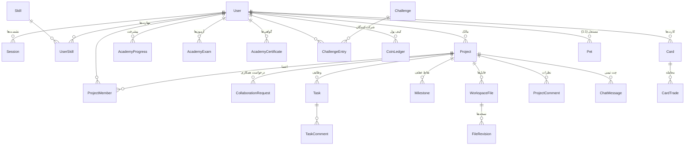

# معماری دیتابیس TEKA NEXUS — ۴۵ مدل

> سند مرجع لایه‌ی داده. منبعِ حقیقت: `prisma/schema.prisma` (PostgreSQL / Supabase). این سند با نسخه‌ی فعلی اسکیما (۴۵ مدل) هم‌گام است.

## ۱) نمای کلی

| موضوع | تصمیم |
|---|---|
| دیتابیس production | **Supabase Postgres** (پروایدر `postgresql`) |
| ORM | Prisma Client (`prisma-client-js`) |
| قرارداد دو-اسکیمایی | `schema.prisma` = production (هرگز sqlite نمی‌شود) · `schema.local.prisma` = آینه‌ی SQLite برای سندباکس (توسط `scripts/postinstall-prisma.ts` خودکار ساخته می‌شود) |
| کانکشن | ران‌تایم از `DATABASE_URL` (pooler/pgbouncer) · مایگریشن از `DIRECT_URL` (پورت ۵۴۳۲، session pooler) |
| باینری‌های Prisma | `native` + `rhel-openssl-3.0.x` + `rhel-openssl-1.0.x` (سازگاری build-image و Lambda در Vercel) |
| شناسه‌ها | `cuid()` برای همه‌ی رکوردها؛ کلیدهای ترکیبی (`@@id`) برای جداول رابطه‌ای |
| Enum ها | SQLite enum ندارد → وضعیت‌ها `String` با اعتبارسنجی در لایه‌ی اپلیکیشن (`src/lib/constants.ts`) |
| فیلدهای چندمقداری | JSON string (`goals`, `interests`, `answers`, `questionIds`, `clues`, …) با پارسرهای مقاوم (`safeParseArray`, `parseAnswers`) |

## ۲) نقشه‌ی دامنه‌ها — ۴۵ مدل در ۱۰ دامنه

| # | دامنه | مدل‌ها | تعداد |
|---|---|---|---|
| ۱ | هویت و احراز هویت | `User`، `Session` | ۲ |
| ۲ | تاکسونومی مهارت | `Skill`، `UserSkill` | ۲ |
| ۳ | پروژه‌ها | `Project`، `ProjectTag`، `ProjectRequiredSkill`، `ProjectMember`، `CollaborationRequest` | ۵ |
| ۴ | ورک‌اسپیس پروژه | `ProjectUpdate`، `Task`، `TaskComment`، `Milestone`، `WorkspaceFile`، `FileRevision`، `DebugLog` | ۷ |
| ۵ | شبکه‌ی اجتماعی | `Follow`، `ProjectLike`، `ProjectSave`، `ProjectComment` | ۴ |
| ۶ | اعلان، گزارش و اعتبار | `Notification`، `UserNotificationPrefs`، `Report`، `ProjectActivity`، `ContributionEvent`، `UserBlock` | ۶ |
| ۷ | آکادمی | `AcademyProgress`، `AcademyCertificate`، `AcademyExam` | ۳ |
| ۸ | پیام‌رسانی | `DmConversation`، `DmMessage`، `ChatMessage` | ۳ |
| ۹ | چالش هفتگی | `Challenge`، `ChallengeEntry` | ۲ |
| ۱۰ | TEKA OS (گیمیفیکیشن) | `Pet`، `BossBattle`، `SkillNodeState`، `WarAction`، `Card`، `CardTrade`، `CoinLedger`، `UserItem`، `SpeedrunRecord`، `CrimeProgress`، `ActivityLog` | ۱۱ |
| | **جمع** | | **۴۵** |

## ۳) شرح مدل‌ها، دامنه به دامنه

### دامنه ۱ — هویت و احراز هویت (۲ مدل)

**`User`** — مرکز کهکشان؛ تقریباً همه‌ی جداول به آن ارجاع می‌دهند.
- احراز هویت: `email @unique`، `username @unique` (نرمال‌شده‌ی lowercase، ۳-۲۴ کاراکتر)، `passwordHash` (scrypt + salt)، `googleId @unique?` (لینک OAuth)
- پروفایل: `displayName`، `bio`، `avatarColor` (کلید گرادیان برند: cyan|violet|ember|lime|rose|gold)، `avatarUrl?`، `websiteUrl`
- گیمیفیکیشن: `xp`، `reputation`، `coins` (بیلانس کش‌شده)، `team` (RED|BLUE)، `title?` (عنوان باس)
- onboarding: `goals` (JSON: build|contribute|learn|discover)، `interests` (JSON)، `onboardingCompleted`
- نقش: `role` = user | moderator | admin

**`Session`** — نشست کوکی‌محور (`teka_session`، httpOnly + sameSite=lax + secure در production).
- `token @unique` (hex تصادفی ۴۸ بایتی)، `expiresAt` (TTL ۳۰ روزه)، `@@index([userId])`
- پاک‌سازی: نشست منقضی هنگام خواندن حذف می‌شود؛ حذف User → حذف آبشاری نشست‌ها

### دامنه ۲ — تاکسونومی مهارت (۲ مدل)

**`Skill`** — `slug @unique` + `name`. لغت‌نامه‌ی مشترک مهارت‌ها بین پروفایل کاربران و نیاز پروژه‌ها.

**`UserSkill`** — رابطه‌ی N:N کاربر↔مهارت با `@@id([userId, skillId])` + `@@index([skillId])`.

### دامنه ۳ — پروژه‌ها (۵ مدل)

**`Project`** — قلب پلتفرم.
- هویت: `slug @unique` (kebab-case)، `name`، `tagline`، `description`
- چرخه‌ی عمر: `status` = IDEA|PLANNING|IN_DEVELOPMENT|BETA|RELEASED|PAUSED|ARCHIVED + `archivedAt?`؛ `visibility` = PUBLIC|PRIVATE|UNLISTED
- ظاهر: `coverImage`، `bgImage`
- لینک‌ها: `repositoryUrl`، `demoUrl`، `websiteUrl`
- ایندکس‌های ترکیبی برای اکسپلور: `@@index([category, status, visibility])` + `createdAt`، `updatedAt`، `ownerId`

**`ProjectTag`** — تگ‌های آزاد با `@@unique([projectId, tag])` و ایندکس روی `tag` برای جست‌وجو.

**`ProjectRequiredSkill`** — N:N پروژه↔مهارت (`@@id([projectId, skillId])`) — مچ‌سازی «چه مهارتی لازم است».

**`ProjectMember`** — عضویت با نقش: OWNER|ADMIN|CONTRIBUTOR|VIEWER؛ `@@unique([projectId, userId])` (عضو تکراری ممنوع).

**`CollaborationRequest`** — درخواست همکاری: `requestedRole`، `introduction`، `portfolioUrl`، `status` = PENDING|ACCEPTED|REJECTED|WITHDRAWN + `reviewedBy(Id/At)`؛ `@@unique([projectId, applicantId])` — بدون درخواست تکراری فعال.

### دامنه ۴ — ورک‌اسپیس پروژه (۷ مدل)

**`ProjectUpdate`** — پست‌های «چه خبر» پروژه؛ ایندکس `[projectId, createdAt]`.

**`Task`** — کانبان: `status` = BACKLOG|TODO|IN_PROGRESS|IN_REVIEW|DONE، `priority` = LOW|NORMAL|HIGH|URGENT، `assignee?` (onDelete: SetNull)، `position Float` (ترتیب drag&drop)، `dueAt?`، `completedAt?`.

**`TaskComment`** — نظر روی وظیفه؛ ایندکس `[taskId, createdAt]`.

**`Milestone`** — نقطه‌ی عطف با `dueAt?` و `completedAt?`.

**`WorkspaceFile`** — فایل‌سیستم مشترک داخل دیتابیس (متن ≤۱۰۰KB، سقف در لایه‌ی API): `folder` (مسیر نرمال‌شده، `/` = ریشه)، `isFolder`، `content`، `language` (از پسوند)، `size`، `starred`؛ `@@unique([projectId, folder, name])` + createdBy/updatedBy (SetNull).

**`FileRevision`** — اسنپ‌شات خودکار روی هر ذخیره (حداکثر ۲۰ نسخه/فایل، هرس در API)؛ ایندکس `[fileId, createdAt]`.

**`DebugLog`** — کنسول دیباگ تیمی: `level` = info|success|warn|error، `source`، `message` ≤۱۰۰۰ کاراکتر.

### دامنه ۵ — شبکه‌ی اجتماعی (۴ مدل)

- **`Follow`** — `@@id([followerId, followingId])` + ایندکس دوطرفه؛ self-relation روی User با دو نام‌گذاری FollowFollower/FollowFollowing
- **`ProjectLike`** — `@@id([userId, projectId])`
- **`ProjectSave`** — ذخیره/بوکمارک؛ همان کلید ترکیبی
- **`ProjectComment`** — کامنت ریشه‌ای/تو در تو (`parentId?`) + **حذف نرم** با `deletedAt?` (بدنه در فید خلاصه می‌شود ولی رکورد می‌ماند)

### دامنه ۶ — اعلان، گزارش و اعتبار (۶ مدل)

**`Notification`** — `type` = NEW_FOLLOWER|PROJECT_COMMENT|COLLAB_REQUEST|REQUEST_ACCEPTED|REQUEST_REJECTED|TASK_ASSIGNED|MEMBER_JOINED|SYSTEM؛ `payload` JSON (فقط رشته‌های نمایشی)؛ `readAt?`؛ ایندکس‌های `[recipientId, readAt]` و `[recipientId, createdAt]`؛ actor اختیاری (SetNull).

**`UserNotificationPrefs`** — ترجیحات ۱:۱ (`userId @id`): projectActivity / collaborationRequests / socialActivity.

**`Report`** — گزارش تخلف: targetType = project|user|comment، reason = SPAM|HARASSMENT|INAPPROPRIATE|COPYRIGHT|OTHER، status = OPEN|REVIEWED|RESOLVED.

**`ProjectActivity`** — لاگ رویداد پروژه برای تایم‌لاین: PROJECT_CREATED|UPDATE_POSTED|MILESTONE_COMPLETED|RELEASE_PUBLISHED|MEMBER_JOINED|TASK_COMPLETED + `metadata` JSON.

**`ContributionEvent`** — ⭐ **دفتر کلید idempotent XP/REP**: `@@unique([userId, eventType, sourceType, sourceId])` یعنی هر رویدادِ منبع فقط یک‌بار جایزه می‌دهد؛ `awardContribution()` در `src/lib/server.ts` روی همین کلید upsert می‌کند.

**`UserBlock`** — بلاک کاربر↔کاربر؛ `@@id([blockerId, blockedId])`.

### دامنه ۷ — آکادمی (۳ مدل)

**`AcademyProgress`** — پیشرفت در هر دوره: `@@unique([userId, courseId])`، `completedLessons` (JSON آرایه‌ی lessonId ها)، `lastLessonId?`.

**`AcademyCertificate`** — گواهی: `code @unique` (مثل `TEKA-PY-8F2KQA`)؛ `@@unique([userId, courseId])` — یک گواهی برای همیشه در هر دوره.

**`AcademyExam`** — آزمون نهایی امن: `status` = ACTIVE|PASSED|FAILED|VOID؛ **`questionIds` فقط id هاست — پاسخ‌های صحیح هرگز به کلاینت نمی‌روند**؛ `answers` JSON از انتخاب‌های کاربر؛ `expiresAt` = تایمر سروری ۱۵ دقیقه‌ای؛ حداکثر ۳ تلاش (VOID تلاش نمی‌سوزد).

### دامنه ۸ — پیام‌رسانی (۳ مدل)

**`DmConversation`** — چت خصوصی ۱:۱: زوج شرکت‌کنندگان **مرتب‌شده‌ی لغت‌نامه‌ای** (`userAId ≤ userBId`) تا `@@unique([userAId, userBId])` حداکثر یک کانورسیشن در هر زوج تضمین کند؛ `lastMessageAt` برای مرتب‌سازی اینباکس.

**`DmMessage`** — پیام DM: `body` ≤۲۰۰۰ کاراکتر (اعتبارسنجی API)، `readAt?` (وقتی گیرنده می‌خواند).

**`ChatMessage`** — چت تیمی هر پروژه (Live Pulse): `body` ≤۵۰۰ کاراکتر؛ پولینگ دلتا ۳ ثانیه‌ای — سازگار با serverless، بدون نیاز به وب‌سوکت.

### دامنه ۹ — چالش هفتگی (۲ مدل)

**`Challenge`** — یک چالش فعال در هر هفته‌ی ایرانی (شنبه→جمعه، محاسبه در `src/lib/week.ts`)؛ در اولین خواندنِ هفته خودکار ساخته می‌شود؛ `xpReward` و `target` (تعداد فعالیت لازم).

**`ChallengeEntry`** — `@@unique([challengeId, userId])`؛ `progress` از فعالیت واقعی بازمحاسبه می‌شود؛ اتمام → XP یک‌بار از طریق `ContributionEvent`.

### دامنه ۱۰ — TEKA OS / گیمیفیکیشن (۱۱ مدل)

| مدل | نقش | نکته‌ی کلیدی |
|---|---|---|
| `Pet` | حیوان خانگی کدی که با یادگیری رشد می‌کند | `userId @unique` (۱:۱)؛ `stage` 0..4 (تخم→افسانه‌ای)؛ گرسنگی ~۱ واحد در ساعت decay |
| `BossBattle` | نبرد باس quiz-محور در هر ماژول | یک ردیف در هر تلاش (ACTIVE|WON|LOST)؛ `questions` JSON، `cursor`، `bossHp/playerHp`؛ `moduleId="__final__"` = باس نهایی دوره |
| `SkillNodeState` | تکمیل نودهای غیردرسی درخت مهارت | `@@unique([userId, nodeId])` |
| `WarAction` | جنگ RED vs BLUE — امتیاز هفتگی | `@@unique([userId, weekKey, kind])` ضد تقلب؛ `weekKey` مثل `2026-W07` |
| `Card` | کارت‌های کلکسیونی شماره‌دار | `serial @unique` (مثل `TEKA-BOSS1-8F2KQA`)؛ `@@unique([userId, kind])`؛ rarity = COMMON..LEGENDARY |
| `CardTrade` | معامله‌ی کارت بین کاربران | status = PENDING|ACCEPTED|DECLINED|CANCELLED؛ ایندکس دوطرفه روی از/به |
| `CoinLedger` | ⭐ دفتر کلید TEKA Coin | `delta` مثبت/منفی + `reason` — `User.coins` فقط کشِ بیلانس است؛ منبع حقیقت این جدول است |
| `UserItem` | آیتم‌های فروشگاه (فریم/عنوان/اسکین پت) | `@@unique([userId, itemKey])`؛ `equipped` |
| `SpeedrunRecord` | رکورد سرعت هر ماژول | `@@index([moduleId, ms])` برای لیدربرد سریع |
| `CrimeProgress` | پیشرفت پرونده‌ی صحنه‌ی جرم | `@@unique([userId, caseId])`؛ `clues` JSON |
| `ActivityLog` | لاگ کل فعالیت‌های OS | سوخت هیت‌مپ پروفایل و ماشین زمان؛ `kind` = lesson|boss|crime|war|pet|card|speedrun|shop|voice|coin |

## ۴) الگوهای سراسری (چرا این‌طور طراحی شده؟)

1. **Idempotency جایزه‌ها** — هر XP/REP/سکه‌ای از `ContributionEvent` (یا `WarAction`/`@@unique` های OS) عبور می‌کند؛ retry و رفرش هرگز دوباره جایزه نمی‌دهد.
2. **Ledger + کش** — پول (`CoinLedger`) و پیشرفت چالش (`ChallengeEntry.progress`) همیشه از منبع اصلی بازمحاسبه‌پذیرند؛ فیلد روی User فقط برای سرعت نمایش است.
3. **حذف نرم vs آبشاری** — محتوای اجتماعی (کامنت پروژه) حذف نرم (`deletedAt`)؛ ساختارهای متعلق به پروژه (Task، فایل، چت، …) با `onDelete: Cascade` همراه پروژه می‌روند؛ ارجاع‌های صرفاً نمایشی (assignee، actor، editor) با `SetNull` خنثی می‌شوند تا تاریخچه‌ی لاگ‌ها نمیرد.
4. **JSON string به‌جای ستون‌بندی** — فیلدهای کم‌ساختار (`payload`، `metadata`، `goals`، `answers`، …) به‌صورت JSON string ذخیره و در لایه‌ی اپ با پارسرهای مقاوم باز می‌شوند (سازگار با آینه‌ی SQLite سندباکس).
5. **امنیت آزمون** — جدول آزمون فقط `questionIds` نگه می‌دارد؛ بانک سوال با پاسخ‌ها (`exam-bank.ts`) سرور-اونلی است و `sanitizeQuestions` تضمین می‌کند پاسخ هرگز به کلاینت نرسد.
6. **ایندکس‌ها روی مسیرهای خواندن واقعی** — فید/اکسپلور (`[category,status,visibility]`، `[projectId,createdAt]`)، اعلان‌ها (`[recipientId, readAt]`)، لیدربرد اسپیدران (`[moduleId, ms]`)، اینباکس DM (`[lastMessageAt]`).

## ۵) جریان‌های مهم (مثال‌های سرتاسری)

- **ثبت‌نام → نشست**: `User` → `createSession()` ردیف `Session` با توکن ۴۸ بایتی → کوکی `teka_session` (httpOnly، secure در production، ۳۰ روز).
- **تکمیل وظیفه**: `Task.status=DONE` → `ProjectActivity` → `ContributionEvent` (کلید یکتا) → `User.xp/reputation`.
- **پاس شدن آزمون**: `AcademyExam.status=PASSED` → `AcademyCertificate` (کد یکتا) → `ContributionEvent` یک‌بارمصرف.
- **چت تیمی**: `ChatMessage` → فید `/api/pulse` → `ChallengeEntry.progress` بازمحاسبه → در صورت رسیدن به `target`: XP چالش.
- **فروشگاه**: کم کردن سکه = ردیف منفی در `CoinLedger` + آپدیت `User.coins` در همان تراکنش + `ActivityLog(kind: shop)`.

---
*نگهداری: هر تغییر در `prisma/schema.prisma` باید این سند را هم به‌روز کند. شمارش مدلی این سند: ۴۵ — با `rg -c '^model ' prisma/schema.prisma` قابل راستی‌آزمایی است.*
